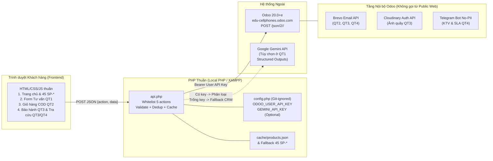

# ĐẶC TẢ KỸ THUẬT & BỘ TÀI LIỆU VIBE CODING: CỔNG WEB CELLPHONES (PHP THUẦN) KẾT NỐI ODOO 20.0+e

- **Hệ thống lõi (Backend ERP/CRM):** Odoo `20.0+e (saas-19.5-1)` — `https://edu-cellphones.odoo.com` (Database: `edu-cellphones`)
- **Phạm vi nghiệp vụ:** Chuỗi bán lẻ CellphoneS mô phỏng 2 chi nhánh (`CH01 - 136 Nguyễn Thái Học` & `CH02 - 21A Hàng Bài`), bám sát **4 quy trình TO-BE (`QT01` → `QT04`)**
- **Người điều phối dữ liệu & API:** Trần Quang Huy (MSSV: `24520706` – TV4)
- **Đối tượng sử dụng tài liệu này:**
  1. **Thành viên thực hiện code giao diện & cầu nối:** Đọc để nắm rõ kiến trúc, tại sao chọn công nghệ này, cần dựng những trang nào, file nào bắt buộc phải có và quy trình test/quay demo.
  2. **AI Vibe Coding (Antigravity / Cursor / Claude / ChatGPT):** Nạp nguyên tệp này làm **Nguồn Sự Thật Duy Nhất (Single Source of Truth)** để sinh code Frontend (`HTML/CSS/JS`) và cầu nối Backend (`api.php`) khớp 100% tên trường, kiểu dữ liệu, ID thật và Selection Key của Odoo `edu-cellphones.odoo.com`.
- **Ngày đối soát Live Odoo:** `21/11/2026`

---

## MỤC LỤC NHANH
1. [Chương 1 – Tổng quan Dự án, Truy vết Rubric & Ranh giới Phạm vi](#chương-1--tổng-quan-dự-án-truy-vết-rubric--ranh-giới-phạm-vi-scope-boundary)
2. [Chương 2 – Quyết định Kiến trúc & Lý do Chọn Công nghệ](#chương-2--quyết-định-kiến-trúc--lý-do-chọn-công-nghệ-architecture-decision-record)
3. [Chương 3 – Cây Thư mục & Danh sách File Bắt buộc](#chương-3--cây-thư-mục--danh-sách-file-bắt-buộc-file-nào-cần-có--tại-sao)
4. [Chương 4 – Đặc tả 4 Màn hình Giao diện Bám sát 4 Quy trình TO-BE](#chương-4--đặc-tả-4-màn-hình-giao-diện-bám-sát-4-quy-trình-to-be)
5. [Chương 5 – Từ điển Dữ liệu, Master Data Live & Fallback 45 Sản phẩm `SP-*`](#chương-5--từ-điển-dữ-liệu-master-data-live--dữ-liệu-fallback-45-sản-phẩm-sp-)
6. [Chương 6 – Hợp đồng Giao tiếp (`Frontend <-> api.php`) & Đặc tả `api.php`](#chương-6--hợp-đồng-giao-tiếp-frontend---apiphp--đặc-tả-kỹ-thuật-file-apiphp)
7. [Chương 7 – Kịch bản Quay Video Demo End-to-End (Web PHP ↔ Odoo TO-BE)](#chương-7--kịch-bản-quay-video-demo-end-to-end-web-php--odoo-to-be)
8. [Chương 8 – Bộ 12 Test Cases Nghiệm thu & Quy ước Dữ liệu Test Nhóm](#chương-8--bộ-12-test-cases-nghiệm-thu-tc-01--tc-12--quy-ước-dữ-liệu-test-nhóm)
9. [Chương 9 – Hướng dẫn Chạy Local trên Windows & Bàn giao 2 Vai trò](#chương-9--hướng-dẫn-cài-đặt--chạy-local-trên-windows-2-vai-trò)
10. [Chương 10 – Prompt Mẫu Copy-Paste Đưa Trực Tiếp Vào AI Vibe Coding](#chương-10--prompt-mẫu-copy-paste-đưa-trực-tiếp-vào-ai-vibe-coding)

---

## Chương 1 – Tổng quan Dự án, Truy vết Rubric & Ranh giới Phạm vi (Scope Boundary)

### 1.1. Mục tiêu của Website PHP này trong đồ án CRM
Website PHP đóng vai trò là **Kênh tiếp nhận & tương tác khách hàng bên ngoài (External Web Portal)** kết nối trực tiếp vào lõi **Odoo CRM / Sales / Helpdesk / Repair** đang vận hành tại `https://edu-cellphones.odoo.com`. Website **không thay thế Odoo**, mà đóng vai trò "cổng đầu vào sạch" giúp chứng minh hệ thống CRM có khả năng tiếp nhận Lead, hứng đơn hàng, ghi nhận yêu cầu bảo hành đóng băng SLA và cho khách hàng tra cứu tiến độ theo thời gian thực.

### 1.2. Bảng truy vết đáp ứng Rubric Đồ án Môn học CRM
| Mã tiêu chí | Yêu cầu trong Rubric | Website PHP + `api.php` đáp ứng phần nào? |
| :---: | :--- | :--- |
| **`A4.4`** | Video thao tác sử dụng phần mềm (cá nhân/nhóm) | Cung cấp giao diện trực quan để quay cảnh khách hàng thao tác ngoài Web và dữ liệu chảy tức thì vào màn hình Odoo Backend. |
| **`A4.7`** | Khám phá và gọi External API / Webhook | `api.php` gọi thật tới Odoo `20.0+e` JSON-2 API (`/json/2/<model>/<method>`) bằng `User API Key`, kèm tích hợp tùy chọn **Google Gemini API** ở `QT01`. |
| **`A4.8`** | Lead Form (Web) & Hứng đơn hàng | Thực hiện qua **Màn hình 2 (Form Tư vấn `QT01` → `crm.lead`)** và **Màn hình 3 (Giỏ hàng & Checkout COD `QT02` → `sale.order`)**. |
| **`A4.10`** | Đề xuất và hiện thực khác biệt, có giá trị cho khách hàng | Hiện thực đủ 3 điểm nhấn TO-BE: (1) AI Gemini phân loại & lọc trùng `res.partner` ở `QT01`; (2) Gửi bảo hành online tự động đặt ở trạng thái đóng băng SLA 72h (`stage_id = 11`) ở `QT03`; (3) Tra cứu tiến độ Repair `WH/RO` theo thời gian thực nhưng **100% No PII** ở `QT03/QT04`. |

### 1.3. Ranh giới Phạm vi: BẮT BUỘC LÀM vs TUYỆT ĐỐI KHÔNG LÀM
Để thành viên và AI không vibe coding lan man thành một trang thương mại điện tử nặng nề ngoài phạm vi đồ án CRM, mọi code sinh ra phải tuân thủ bảng ranh giới sau:

| BẮT BUỘC PHẢI LÀM (In-Scope) | TUYỆT ĐỐI KHÔNG LÀM (Out-of-Scope) |
| :--- | :--- |
| 1. Hiển thị danh mục **45 sản phẩm `SP-*`** lấy từ Odoo (có bộ lọc nhóm, tìm kiếm, badge hàng sẵn quầy). | 1. **Không làm** Đăng nhập / Đăng ký / Quên mật khẩu / Hồ sơ thành viên trên web. |
| 2. **Form Tư vấn Mua hàng (`QT01`)**: tích hợp tùy chọn Gemini API phân loại + lọc trùng `res.partner` + tạo thẳng `Opportunity [New]`. | 2. **Không làm** cổng thanh toán thật (VNPay, MoMo, Stripe, thẻ ngân hàng) hay tính phí ship theo quận/huyện. |
| 3. **Giỏ hàng (`localStorage`) & Đặt hàng nhanh COD (`QT02`)**: tạo Báo giá/Đơn nháp `sale.order [draft]` trên Odoo. | 3. **Không làm** trang Admin Dashboard riêng trên PHP để quản lý đơn hàng/khách hàng (việc đó làm trên Odoo). |
| 4. **Form Gửi Bảo hành Online (`QT03`)**: đẩy `helpdesk.ticket` vào đúng `stage_id = 11` (đóng băng SLA 72h) và map đúng trường Studio `x_studio_*`. | 4. **Không làm** Database MySQL/SQLite riêng trên máy PHP (Odoo là DB duy nhất; PHP chỉ dùng file JSON cache nhẹ). |
| 5. **Tra cứu Tiến độ Bảo hành & Sửa chữa (`QT03`/`QT04`)**: khớp Mã Ticket + SĐT, chỉ hiện trạng thái `stage_id` và `repair.order`, **ẩn 100% PII**. | 5. **Không gọi** API Odoo trực tiếp từ JavaScript trình duyệt (`fetch('https://edu-cellphones.odoo.com/...')` bị CẤM hoàn toàn). |
|  | 6. **Không sửa hoặc xóa** dữ liệu có sẵn của các thành viên khác trên Odoo khi chạy test. |

---

## Chương 2 – Quyết định Kiến trúc & Lý do Chọn Công nghệ (Architecture Decision Record)

### 2.1. Sơ đồ Kiến trúc Tổng thể



### 2.2. Tại sao chọn công cụ này thay vì công cụ khác?

| Lựa chọn Công nghệ | Tại sao CHỌN cho dự án này? | Tại sao KHÔNG chọn các phương án thay thế? |
| :--- | :--- | :--- |
| **Frontend: HTML5 + CSS3 + Vanilla JS (hoặc Tailwind CDN)** | Chạy ngay trên mọi trình duyệt không cần Node.js/npm/build step; AI vibe coding sinh UI CellphoneS cực nhanh, dễ đọc và không lỗi tương thích phiên bản thư viện. | **Không chọn React/Next.js/Vue:** Phải cài Node, cấu hình bundler, chia 2 server chạy dev dễ lỗi port/CORS khi quay demo.<br>**Không chọn Odoo Website Builder:** Khó tùy biến giao diện hiện đại trên bản SaaS, bị giới hạn QWeb & whitelist form. |
| **Cầu nối Backend: 1 file PHP thuần (`api.php`) + cURL** | Có sẵn trên Windows qua PHP CLI (`php -S localhost:8000`) hoặc XAMPP; bọc kín `ODOO_USER_API_KEY` phía server; không cần cài Composer hay framework Laravel nặng nề. | **Không chọn WordPress + Plugin WooCommerce-Odoo:** Đa số plugin miễn phí dùng giao thức XML-RPC/JSON-RPC cũ và rất khó ánh xạ đúng vào 17 trường Studio `x_studio_*` của nhóm.<br>**Không chọn Node/Python server riêng + MySQL:** Thừa hạ tầng vì Odoo đã là Backend & Database lõi. |
| **Giao tiếp Odoo: JSON-2 External API (`/json/2/<model>/<method>`)** | Là giao thức mới chuẩn của Odoo `20.0+e`, dùng HTTP POST + JSON thuần + `Bearer Token`, đã được kiểm chứng chạy thành công ở Task `[CN-T]`. | **Không chọn XML-RPC:** Rườm rà, dễ lỗi kiểu dữ liệu PHP XML-RPC extension (nhiều bản PHP Windows tắt sẵn `ext-xmlrpc`). |
| **Xác thực: `User API Key`** | Tạo trực tiếp trong *Preferences → Account Security → API Keys*, chạy hợp lệ trên mọi endpoint `/json/2/`. | **Không dùng MCP Key (`_oak`):** Khóa MCP chỉ được phép gọi `/mcp`; gửi lên `/json/2/` sẽ bị Odoo trả lỗi **`HTTP 401 Unauthorized`**. |

### 2.3. Phân tầng 4 API bên thứ ba của bộ Quy trình TO-BE
Trong hồ sơ quy trình TO-BE của nhóm có 4 API ngoài. Website PHP này **chỉ tích hợp trực tiếp 1 API ngoài (tùy chọn)** tại điểm chạm đầu vào, còn 3 API còn lại thuộc tầng vận hành nội bộ Odoo:

1. **Google Gemini API (`Structured Outputs`) — TÍCH HỢP TÙY CHỌN TẠI `api.php` (`QT01 TO-BE`):**
   * *Lý do đặt ở `api.php`:* Khi khách gửi Form Tư vấn trên web, nếu `config.php` có điền `GEMINI_API_KEY`, `api.php` gọi Gemini phân loại tin nhắn thành 1 trong 3 nhãn (`Tư vấn mua hàng`, `Bảo hành`, `Khiếu nại`) + tóm tắt 1 câu trước khi đẩy vào Odoo. Nếu `GEMINI_API_KEY` để trống, quá timeout 5s, hoặc AI đánh dấu mơ hồ (`is_ambiguous = true`), hệ thống **tự động Fallback** đẩy thẳng về `crm.lead` giữ nguyên nội dung gốc cho nhân viên đọc.
2. **Brevo Transactional Email API (`QT02`, `QT03`, `QT04`):** Thuộc kích hoạt nội bộ Odoo sau khi nhân viên báo giá/xác nhận đơn (`WH/OUT Done`), hẹn nhận máy, gửi khảo sát CSAT. Public Web không tự ý gửi email thay Odoo.
3. **Cloudinary Upload API (`type=authenticated` + Signed URL — `QT03`):** Chỉ kích hoạt tại quầy khi nhân viên bấm *Nhận giữ thiết bị tại quầy = Nhận máy* để chụp ảnh ngoại quan và ảnh bàn giao 2 đầu. Form Online trên Web thuộc nhánh *Không giữ máy tại quầy* nên **không upload ảnh lên Cloudinary từ Web**.
4. **Telegram Bot API (`100% No PII` — `QT04`):** Dùng báo nội bộ giữa Quầy CH01/CH02 và Kỹ thuật viên (`WH/RO` mới / cảnh báo quá hạn `EX-06`), nằm sau tầng Odoo Automation, không liên quan giao diện khách hàng.

---

## Chương 3 – Cây Thư mục & Danh sách File Bắt buộc (File nào cần có & Tại sao?)

### 3.1. Cấu trúc Thư mục Chuẩn của Dự án Web
Khi vibe coding hoàn chỉnh, toàn bộ mã nguồn web phải nằm gọn theo đúng cấu trúc dưới đây (ví dụ đặt tại thư mục `web_portal/` hoặc thư mục riêng ngoài `docs/`):

```text
cellphones-web/
├── index.html                  # Giao diện 1 trang (SPA 4 tab/view) hiển thị cho khách hàng
├── assets/
│   ├── css/
│   │   └── style.css           # Giao diện CellphoneS (#D70018), card sản phẩm, progress bar, responsive
│   └── js/
│       └── app.js              # Logic UI: lọc SP, giỏ hàng localStorage, validate form, gọi POST api.php
├── api.php                     # Cầu nối Backend PHP duy nhất: bọc Key, whitelist 5 action, gọi Odoo/Gemini
├── config.example.php          # File mẫu cấu hình (commit lên Git để thành viên biết các biến cần có)
├── config.php                  # File cấu hình THẬT chứa API Key & MOCK_MODE (CHỈ Huy giữ, CẤM push Git)
├── .gitignore                  # Chặn Git theo dõi config.php và cache/products.json
├── data/
│   └── products_fallback.json  # Bản sao JSON 45 sản phẩm SP-* trích từ Live Odoo dùng khi offline/fallback
└── cache/
    └── .gitkeep                # Giữ thư mục rỗng để PHP ghi file cache/products.json (TTL 300s)
```

### 3.2. Giải thích từng File: Bắt buộc hay không & Tại sao phải có?

| Đường dẫn File | Bắt buộc? | Vai trò kỹ thuật (Tại sao phải có?) | Commit lên Git? | Hậu quả nếu thiếu / làm sai |
| :--- | :---: | :--- | :---: | :--- |
| `index.html` | **Có** | Khung HTML chứa 4 khu vực nghiệp vụ bám sát TO-BE, modal/popup thông báo kết quả. | Có | Không có giao diện để thao tác và quay video demo. |
| `assets/css/style.css` | **Có** | Định hình nhận diện CellphoneS (`#D70018`), chia grid thẻ sản phẩm, bảng chi tiết giỏ hàng, thanh tiến độ 6 bước tra cứu, co giãn Mobile `375px`. | Có | Giao diện vỡ bố cục, không đạt chuẩn thẩm mỹ khi demo. |
| `assets/js/app.js` | **Có** | Điều khiển chuyển tab, lọc 45 SP, lưu giỏ hàng `localStorage`, kiểm tra Regex SĐT trước khi gửi, khóa nút chống double-click, gọi `fetch('api.php')`. | Có | Form không gửi được dữ liệu, dễ bấm đúp tạo trùng đơn trên Odoo. |
| `api.php` | **Có** | Lớp bảo vệ & chuẩn hóa: đọc `config.php`, chặn `action` lạ, tra trùng `res.partner`, gán cứng `team_id`/Selection Key Odoo, gọi `cURL` sang `edu-cellphones.odoo.com`. | Có | Lộ `ODOO_USER_API_KEY` ra trình duyệt, lỗi CORS, hoặc bị Odoo từ chối `400 Bad Request` do sai Selection Key. |
| `config.example.php` | **Có** | Chứa cấu trúc hằng số mẫu (`MOCK_MODE = true`, chuỗi placeholder `<ODOO_USER_API_KEY>`) để thành viên chạy test mock ngay và Huy chỉ việc copy sang `config.php`. | Có | Thành viên không biết tên hằng số để cấu hình, hoặc AI tự đặt tên biến lệch với `api.php`. |
| `config.php` | **Có** *(khi chạy thật)* | Lưu `ODOO_USER_API_KEY` thật, `GEMINI_API_KEY` (tùy chọn), và cờ `MOCK_MODE = false`. | **TUYỆT ĐỐI KHÔNG** | Thiếu file này `api.php` không chạy được live; nếu lỡ commit lên GitHub sẽ **lộ khóa truy cập toàn bộ Odoo nhóm**. |
| `.gitignore` | **Có** | Khai báo rõ `config.php`, `cache/*.json`, `.env` để Git bỏ qua tự động. | Có | Rủi ro cực cao vô tình `git add .` đẩy API Key lên GitHub công khai. |
| `data/products_fallback.json` | **Có** | Lưu sẵn 45 sản phẩm `SP-*` với `id` thật từ Odoo để web hiển thị ngay cả khi chạy `MOCK_MODE = true`, mất mạng hoặc Odoo bảo trì. | Có | Khi thành viên vibe code chưa có API Key hoặc Odoo lỗi mạng, trang chủ trống trơn không test được giỏ hàng. |
| `cache/.gitkeep` | Khuyến nghị | Đảm bảo thư mục `cache/` tồn tại để `api.php` ghi tệp tạm `cache/products.json` giảm số lần gọi Odoo `search_read`. | Có | PHP báo warning `failed to open stream` khi ghi cache nếu thư mục `cache/` chưa được tạo. |

---

## Chương 4 – Đặc tả 4 Màn hình Giao diện Bám sát 4 Quy trình TO-BE

### 4.1. Quy chuẩn UI/UX chung cho toàn bộ Frontend
* **Bảng màu CellphoneS:** Màu nhấn chủ đạo `#D70018` (đỏ), đỏ hover `#B80014`, nền trang `#F4F6F8`, nền thẻ `#FFFFFF`, chữ chính `#1A1A1A`, chữ phụ `#666666`, xanh trạng thái sẵn hàng `#16A34A`, vàng cảnh báo SLA tạm dừng `#D97706`.
* **4 Trạng thái bắt buộc trên mọi Form (`QT01`, `QT02`, `QT03`, `Tra cứu`):**
  1. **Validate Client trước khi gọi API:** Kiểm tra các ô bắt buộc không được trống; SĐT hợp lệ theo Regex VN `/^0[35789][0-9]{8}$/` (cho phép người dùng gõ dấu cách/`+84` nhưng JS tự strip hoặc báo rõ nếu sai độ dài); báo viền đỏ + thông báo lỗi ngay dưới ô nhập sai.
  2. **Trạng thái Loading & Chống bấm đúp (Anti Double-Submit):** Ngay khi bấm nút Gửi/Đặt hàng/Tra cứu, nút phải chuyển `disabled = true`, hiện spinner + chữ `"Đang xử lý đồng bộ Odoo..."` cho tới khi `api.php` trả về kết quả.
  3. **Trạng thái Success:** Hiển thị hộp thông báo/Modal xanh lá rõ ràng kèm **Mã bản ghi thật từ Odoo** (ví dụ: Mã cơ hội `OPP #25`, Mã báo giá `S00022`, Mã phiếu bảo hành `#00032`), kèm nút *"Copy mã"* và reset form/giỏ hàng sạch sẽ.
  4. **Trạng thái Error:** Nếu `api.php` trả `ok: false` hoặc mất mạng, hiện hộp báo lỗi đỏ dễ hiểu và **TUYỆT ĐỐI KHÔNG xóa trắng các ô khách vừa gõ** để khách sửa/gửi lại được ngay.

### 4.2. Đặc tả chi tiết 4 Màn hình / Khu vực Chức năng

#### Màn hình 1: Trang chủ & Danh mục Sản phẩm (`QT01` & `QT02` Entry Point)
* **Nguồn dữ liệu:** Gọi `POST api.php` với `action: "get_products"` ngay khi tải trang.
* **Thành phần giao diện:**
  * Thanh điều hướng Top Bar gồm Logo `CellphoneS CRM Demo` + 4 nút chuyển Tab/Section: **Sản phẩm** | **Tư vấn mua hàng (`QT1`)** | **Giỏ hàng (`QT2` + badge số lượng)** | **Bảo hành & Tra cứu (`QT3`/`QT4`)**.
  * Thanh tìm kiếm theo tên hoặc mã `SP-*` + 7 nút lọc danh mục: `Tất cả (45)`, `Điện thoại (16)`, `Laptop (12)`, `Tablet (4)`, `Đồng hồ thông minh (3)`, `Âm thanh (3)`, `Phụ kiện (7)`.
  * Checkbox lọc nhanh: *"Chỉ hiện sản phẩm có sẵn hàng tại quầy (Demo xuất kho WH/OUT)"*.
  * Thẻ sản phẩm (`Product Card`) hiển thị: Mã `default_code`, Tên sản phẩm, Nhóm danh mục, Giá bán định dạng `34.990.000 ₫`, Mô tả bảo hành ngắn (`description_sale`), và Badge trạng thái tồn kho:
    * Nếu `qty_available > 0`: Badge xanh lá **`Sẵn hàng tại quầy (SL: X) – Hỗ trợ demo xuất kho WH/OUT`**.
    * Nếu `qty_available == 0`: Badge xám nhẹ **`Đặt trước / Giao từ kho tổng`**.
  * 2 nút hành động trên mỗi thẻ:
    * **`Tư vấn SP này`**: Chuyển sang Màn hình 2 (`QT01`) và tự điền tên + `id` sản phẩm vào Form Tư vấn.
    * **`+ Thêm vào giỏ`**: Cộng sản phẩm vào giỏ hàng `localStorage` (kèm toast thông báo nhỏ góc màn hình).

#### Màn hình 2: Form Đăng ký Tư vấn Mua hàng (`QT01 TO-BE` – Tiêu chí `A4.8`)
* **Mục đích nghiệp vụ:** Thu thập nhu cầu khách hàng online, tự động phân loại bằng Gemini (nếu bật), tra trùng Contact `res.partner` theo SĐT và đẩy thẳng thành **Cơ hội bán hàng (`type = "opportunity"`, `stage_id = 1 [New]`)** gán đúng đội `CH01` hoặc `CH02`.
* **Danh sách ô nhập liệu (Fields):**
  1. **Họ và tên khách hàng** (`contact_name`) — Text — **Bắt buộc**.
  2. **Số điện thoại** (`phone`) — Tel, Regex `0[35789]xxxxxxxx` — **Bắt buộc**.
  3. **Email liên hệ** (`email_from`) — Email — *Không bắt buộc* (ghi chú nhắc: ưu tiên `.edu.vn` nếu đăng ký `S-Student` / `S-Teacher`).
  4. **Chi nhánh muốn tư vấn** (`branch`) — Radio/Select — **Bắt buộc**: `CH01` (`CH01 - 136 Nguyễn Thái Học, Q.1`) hoặc `CH02` (`CH02 - 21A Hàng Bài / 377 Điện Biên Phủ`).
  5. **Phân nhóm ưu đãi** (`customer_segment`) — Select — Mặc định `standard`: `Khách hàng cá nhân`, `Học sinh - Sinh viên (S-Student)`, `Giáo viên (S-Teacher)`.
  6. **Sản phẩm quan tâm** (`product_id`, `product_name`) — Select từ danh sách 45 SP (cho phép chọn *"Chưa xác định / Tư vấn chung"*) — *Không bắt buộc*.
  7. **Nội dung nhu cầu chi tiết** (`note`) — Textarea — **Bắt buộc** (gợi ý placeholder: *"VD: Cần tư vấn iPhone 18 Pro Max bản 256GB, có hỗ trợ thu cũ đổi mới không?..."*).
* **Hiển thị kết quả trả về (`ok: true`):**
  * Hiển thị Mã Cơ hội Odoo (`#ID`) + Chi nhánh phụ trách (`Đội bán hàng CH01` / `CH02`) + Trạng thái nhận diện khách hàng (`Khách hàng cũ – Đã gắn hồ sơ 360°` hoặc `Đã tạo hồ sơ khách hàng mới`).
  * Nếu Gemini hoạt động: hiện thêm khung nhỏ **"AI Gemini Phân loại tự động"** gồm Nhãn phân loại (`Tư vấn mua hàng` / `Bảo hành` / `Khiếu nại`) + Câu tóm tắt 1 dòng. Nếu khách gõ nhầm nội dung xin bảo hành vào Form Tư vấn và AI định tuyến sang Helpdesk (`routed_to == "helpdesk"`), thông báo rõ mã Ticket bảo hành `#000XX` đã được tách luồng sang đội Bảo hành đúng như `QT01 TO-BE`.

#### Màn hình 3: Giỏ hàng & Đặt hàng nhanh COD (`QT02 TO-BE` – Tiêu chí `A4.8`)
* **Mục đích nghiệp vụ:** Hứng đơn hàng trực tiếp từ Web đẩy về Odoo tạo **Báo giá / Đơn bán hàng (`sale.order` trạng thái `draft`)** gắn đúng `res.partner`, `team_id` chi nhánh và `order_line` chuẩn `product_id` để Sales trên Odoo kiểm tra tồn kho, bấm `Confirm` và xuất kho `WH/OUT`.
* **Thành phần giao diện:**
  * **Cột trái (Danh sách giỏ hàng từ `localStorage`):** Tên SP, mã `SP-*`, đơn giá, nút `-` / `+` chỉnh số lượng (`>= 1`), nút `Xóa`, thành tiền từng dòng. Cảnh báo nhỏ nếu giỏ có sản phẩm tồn kho `0` (*"Ghi chú: Để test xuất kho `WH/OUT` ngay khi demo, ưu tiên chọn 3 mã có badge Sẵn hàng tại quầy"*).
  * **Cột phải (Tổng kết & Form Checkout COD tối giản):**
    * Hiển thị: Tạm tính, Thuế VAT (10% tham khảo – hiển thị ghi chú *"Odoo sẽ tự áp bảng thuế chính thức trên Báo giá"*), Tổng tạm tính.
    * Các ô nhập:
      1. **Họ và tên người nhận** (`customer_name`) — Text — **Bắt buộc**.
      2. **Số điện thoại đặt hàng** (`phone`) — Tel — **Bắt buộc**.
      3. **Email nhận hóa đơn/xác nhận** (`email`) — Email — *Không bắt buộc*.
      4. **Chi nhánh xử lý & giao hàng** (`branch`) — Radio/Select (`CH01` / `CH02`) — **Bắt buộc**.
      5. **Địa chỉ nhận / Ghi chú giao hàng** (`address`) — Textarea — *Không bắt buộc* (mặc định nếu trống: *"Nhận tại quầy chi nhánh đã chọn"*).
      6. **Phương thức thanh toán** — Khóa cứng 1 lựa chọn duy nhất: `Thanh toán khi nhận hàng / Tại quầy (COD - Mô phỏng đồ án)`.
* **Hiển thị kết quả trả về:** Hiện **Mã Đơn hàng/Báo giá Odoo (`S000XX`)**, Tổng tiền Odoo tính trả về (`amount_total`), và nút link mở nhanh tới danh sách đơn (hoặc chỉ dẫn nhân viên vào `Sales > Orders` xác nhận). Xóa giỏ hàng sau khi đặt thành công.

#### Màn hình 4: Bảo hành Online & Tra cứu Tiến độ (`QT03` & `QT04 TO-BE`)
Gồm 2 sub-tab rõ ràng:

* **Tab 4A – Form Gửi Yêu cầu Bảo hành / Đổi trả Online (`QT03 TO-BE`):**
  * **Thông báo nghiệp vụ đầu Form:** *"Sau khi gửi yêu cầu online, hệ thống sẽ tạo phiếu ở trạng thái Chờ mang máy ra quầy (đóng băng đồng hồ SLA 72h). Đồng hồ SLA chỉ bắt đầu chạy khi bạn mang máy tới quầy CH01/CH02 kiểm tra ngoại quan."*
  * **Danh sách ô nhập liệu (Map trực tiếp vào trường Studio `helpdesk.ticket`):**
    1. **Họ và tên** (`partner_name`) — Text — **Bắt buộc**.
    2. **Số điện thoại liên hệ & tra cứu** (`partner_phone`) — Tel — **Bắt buộc** *(đồng thời ghi vào `x_studio_sdt_tra_cuu`)*.
    3. **Email liên hệ** (`partner_email`) — Email — *Không bắt buộc*.
    4. **Cửa hàng dự kiến gửi máy** (`branch`) — Select: `CH01` / `CH02` — **Bắt buộc** *(PHP sẽ tự map sang key chính xác của `x_studio_cua_hang_tiep_nhan`)*.
    5. **Loại yêu cầu** (`loai_yeu_cau`) — Select: `Bảo hành sửa chữa`, `Đổi trả sản phẩm`, `Khiếu nại / Tư vấn hậu mãi` — **Bắt buộc**.
    6. **Chọn thiết bị theo danh mục** (`product_id`) — Select từ 45 SP `SP-*` + lựa chọn *"Khác / Không có trong danh mục"* — *Không bắt buộc*.
    7. **Tên thiết bị ghi nhận** (`ten_thiet_bi`) — Text — **Bắt buộc** *(tự động điền nếu khách chọn ở ô trên, cho phép sửa tay)*.
    8. **Số IMEI / Serial** (`so_imei_serial`) — Text (gợi ý bấm `*#06#`) — *Không bắt buộc*.
    9. **Tiêu đề yêu cầu** (`subject`) — Text — **Bắt buộc**.
    10. **Mô tả chi tiết tình trạng lỗi** (`description`) — Textarea — **Bắt buộc**.
  * **Kết quả trả về:** Hiện **Mã Ticket 5 chữ số (`#000XX`)**, nhắc khách giữ lại **Mã Ticket + SĐT** để tra cứu ở Tab 4B và mang máy ra chi nhánh đã chọn.

* **Tab 4B – Tra cứu Tiến độ Bảo hành & Sửa chữa (`QT03` & `QT04 TO-BE`):**
  * **Form tra cứu 2 ô (Bắt buộc cả 2 để chống dò lén thông tin khách khác):**
    1. **Mã phiếu bảo hành** (`ticket_code`) — Text (nhập `00031`, `#00031`, hoặc `31`) — **Bắt buộc**.
    2. **Số điện thoại đã đăng ký** (`phone`) — Tel — **Bắt buộc**.
  * **Giao diện kết quả (`ok: true`, 100% No PII):**
    * Tiêu đề phiếu (`name`), Mã phiếu (`#000XX`), Chi nhánh tiếp nhận (nhãn hiển thị gọn `[CH01]`/`[CH02]`), Badge trạng thái SLA (`SLA đang tạm dừng chờ khách/linh kiện` nếu đang ở `stage_id = 11`).
    * **Thanh tiến độ 6 bước Helpdesk (Stepper):**
      1. `Mới tiếp nhận` (`1`) → 2. `Đang xác minh` (`2`) → 3. `Chờ khách / Chờ linh kiện` (`11`) → 4. `Đang xử lý` (`12`) → 5. `Đã giải quyết` (`13`) → 6. `Đóng` (`6`).
    * **Khối Trạng thái Lệnh Sửa chữa Kỹ thuật (`QT04` – nếu Ticket đã gắn `WH/RO`):** Liệt kê từng `repair.order` gồm Mã lệnh (`WH/RO/00002`), Tình trạng bảo hành (`Trong bảo hành` / `Ngoài bảo hành`), và 1 trong 4 trạng thái chuẩn: `Mới tạo lệnh (draft)` / `Đang sửa chữa (confirmed)` / `Hoàn tất sửa chữa (done)` / `Đã hủy (cancel)`.
    * **Cam kết bảo mật No PII:** Giao diện KHÔNG hiển thị IMEI/Serial, Email, Tên đầy đủ khách hàng, Chi phí sửa chữa hay Ghi chú nội bộ của kỹ thuật viên.

---

## Chương 5 – Từ điển Dữ liệu, Master Data Live & Dữ liệu Fallback 45 Sản phẩm `SP-*`

### 5.1. Bảng Master ID Thực tế trên Odoo `https://edu-cellphones.odoo.com`
> **Quy tắc cứng:** AI và lập trình viên phải dùng **chính xác các ID số nguyên và chuỗi dưới đây**, tuyệt đối không tự suy đoán ID khác.

| Nhóm cấu hình (Model) | ID / Key thật trên Odoo | Tên hiển thị / Ý nghĩa nghiệp vụ | Ghi chú sử dụng trong `api.php` |
| :--- | :---: | :--- | :--- |
| **`crm.team`** | **`4`** | `Đội bán hàng CH01 (Chi nhánh 136 Nguyễn Thái Học, Quận 1).` | Gán cho `team_id` khi khách chọn `CH01` (`QT1`, `QT2`). |
| **`crm.team`** | **`5`** | `Đội bán hàng CH02 (Chi nhánh 21A Hàng Bài / 377 Điện Biên Phủ).` | Gán cho `team_id` khi khách chọn `CH02` (`QT1`, `QT2`). |
| **`crm.team`** | `2` *(CẤM dùng)* | `Website` (`use_leads=false`, `use_opportunities=false`) | **KHÔNG gán** vào `crm.lead` vì không chạy pipeline bán hàng. |
| **`crm.stage`** | **`1`** | `New` | Giai đoạn mặc định khi tạo `Opportunity` từ Web (`QT1`). |
| **`crm.stage`** | `2`, `3`, `4` | `Qualified` (`2`), `Proposition` (`3`), `Won` (`4`) | Dùng để nhân viên đẩy tiến độ trong Odoo ở `QT2`. |
| **`crm.lost.reason`** | `1`, `3`, `4` | `Too expensive` (`1`), `Not enough stock` (`3`), `Khách ngừng nhận tư vấn` (`4`) | Tham chiếu báo cáo Win/Loss (`QT2`). |
| **`utm.source`** | **`15`** | `Website` | Gán vào `source_id` của `crm.lead` để đo nguồn Web Portal. |
| **`stock.warehouse`** | **`1`** | `cellphones` (`code: "WH"`) | Gán mặc định `warehouse_id = 1` cho `sale.order`. |
| **`res.partner.category`** | **`43`**, **`56`** | `[Chi nhánh] CH01 - 134 Nguyễn Thái Học` (`43`), `[Chi nhánh] CH02 - 377 Điện Biên Phủ` (`56`) | Gắn Tag chi nhánh cho khách hàng khi tạo/cập nhật `res.partner`. |
| **`res.partner.category`** | **`55`**, **`49`** | `[Ưu đãi] S-Student` (`55`), `[Ưu đãi] S-Teacher` (`49`) | Gắn Tag ưu đãi tương ứng từ Form Tư vấn `QT1`. |
| **`res.partner.category`** | **`50`**, **`93`** | `[SMember] S-New` (`50`), `[Vai trò] Khách hàng cá nhân` (`93`) | Gắn Tag mặc định khi tạo mới `res.partner` từ Web. |
| **`helpdesk.team`** | **`2`** | `CellphoneS – Bảo hành & Đổi trả` | Bắt buộc gán `team_id = 2` cho mọi `helpdesk.ticket` từ Web. |
| **`helpdesk.stage`** | `1`, `2`, **`11`**, `12`, `13`, `6` | `Mới tiếp nhận` (`1`) → `Đang xác minh` (`2`) → **`Chờ khách / Chờ linh kiện` (`11`)** → `Đang xử lý` (`12`) → `Đã giải quyết` (`13`) → `Đóng` (`6`) | Web tạo mới Ticket Bảo hành Online ở **`stage_id = 11`** (kích hoạt đóng băng SLA 72h đúng `QT03 TO-BE`). |
| **`helpdesk.sla`** | `1`, `2` | SLA 1 (`24h` → `Đang xử lý` `12`, không pause)<br>SLA 2 (`72h` → `Đã giải quyết` `13`, **`exclude_stage_ids = [11]`**) | Chứng minh SLA 72h tạm dừng tự động khi Ticket nằm ở `stage_id = 11`. |
| **`repair.order.state`** | `draft`, `confirmed`, `done`, `cancel` | `New` (`draft`), `Confirmed` (`confirmed`), `Done` (`done`), `Cancelled` (`cancel`) | Chỉ có đúng **4 giá trị** này trên Odoo `20.0+e` (KHÔNG có `under_repair`). |

### 5.2. Từ điển Trường Dữ liệu Chuẩn API cho 5 Model Odoo

#### A. Model `res.partner` (Hồ sơ Khách hàng 360°)
| Tên kỹ thuật | Nhãn hiển thị | Kiểu Odoo | Định dạng / Quy tắc | Bắt buộc? | Mapping / Ghi chú |
| :--- | :--- | :--- | :--- | :---: | :--- |
| `id` | ID | `integer` | Số nguyên dương | Readonly | Dùng làm `partner_id` cho Lead, Order, Ticket. |
| `name` | Name | `char` | Chuỗi không rỗng, tối đa 120 ký tự | **Có** | Họ tên khách hàng nhập từ Web. |
| `phone` | Phone | `char` | Chuỗi `0[35789]xxxxxxxx` (10 số) | **Có** | Khóa chính nghiệp vụ để chống tạo trùng khách hàng. |
| `phone_sanitized` | Sanitized Number | `char` | Odoo tự sinh dạng `+84xxxxxxxxx` | Readonly | Dùng trong `domain` tìm trùng song song với `phone`. |
| `email` | Email | `char` | Email hợp lệ hoặc bỏ trống (`false`) | Không | Không truyền chuỗi rỗng `""` nếu khách không nhập; bỏ qua hoặc `false`. |
| `street` | Street | `char` | Chuỗi địa chỉ nhận hàng COD | Không | Cập nhật khi khách đặt hàng có điền địa chỉ. |
| `category_id` | Tags | `many2many` | Lệnh Odoo X2many | Khuyến nghị | Tạo mới: `[[6, 0, [93, 50, branch_tag_id, ...]]]`; Cập nhật Contact sẵn có: `[[4, tag_id, 0]]` để không xóa tag cũ! |

#### B. Model `crm.lead` (Cơ hội Bán hàng – `QT01 TO-BE`)
| Tên kỹ thuật | Nhãn hiển thị | Kiểu Odoo | Định dạng / Quy tắc | Bắt buộc? | Mapping / Ghi chú |
| :--- | :--- | :--- | :--- | :---: | :--- |
| `name` | Opportunity | `char` | `[WP-DEMO] <Họ tên> - <Sản phẩm/Nhu cầu>` | **Có** | Ngắn gọn, có tiền tố `[WP-DEMO]` khi test đồ án. |
| `type` | Type | `selection` | Bắt buộc truyền **`"opportunity"`** | **Có** | Khớp `QT01 TO-BE`: bỏ bước tạo Lead trung gian, vào thẳng `Opportunity`. |
| `stage_id` | Stage | `many2one` | Số nguyên **`1`** (`New`) | **Có** | Đặt thẳng ở cột đầu tiên Pipeline. |
| `partner_id` | Contact | `many2one` | `id` của `res.partner` đã tìm/tạo | **Có** | Liên kết Contact 360° (không tạo mới mù quáng). |
| `contact_name` | Contact Name | `char` | Chuỗi họ tên | Khuyến nghị | Đồng bộ hiển thị trên Lead/Opp. |
| `phone` | Phone | `char` | `0[35789]xxxxxxxx` | **Có** | SĐT liên hệ. |
| `email_from` | Email | `char` | Email hợp lệ hoặc bỏ qua | Không | Gán nếu khách có nhập. |
| `team_id` | Sales Team | `many2one` | **`4`** (`CH01`) hoặc **`5`** (`CH02`) | **Có** | Tuyệt đối không gán `2` (`Website`). |
| `source_id` | Source | `many2one` | **`15`** (`Website`) | Khuyến nghị | Ghi nhận nguồn Web Portal. |
| `expected_revenue` | Expected Revenue | `monetary` | Số thực (VNĐ), mặc định `0` | Không | Gán bằng `list_price` của sản phẩm nếu khách chọn SP cụ thể. |
| `description` | Notes | `html` | Chuỗi HTML đã `htmlspecialchars()` | Khuyến nghị | Chứa kết quả phân loại Gemini (hoặc ghi chú Fallback), chi nhánh, ưu đãi và lời nhắn gốc. |

#### C. Model `sale.order` & `sale.order.line` (Đơn hàng COD – `QT02 TO-BE`)
| Tên kỹ thuật | Nhãn hiển thị | Kiểu Odoo | Định dạng / Quy tắc | Bắt buộc? | Mapping / Ghi chú |
| :--- | :--- | :--- | :--- | :---: | :--- |
| `partner_id` | Customer | `many2one` | `id` của `res.partner` | **Có** | Tìm/tạo khách hàng theo SĐT trước khi tạo đơn. |
| `team_id` | Sales Team | `many2one` | **`4`** (`CH01`) hoặc **`5`** (`CH02`) | **Có** | Chi nhánh phụ trách báo giá & xuất kho. |
| `warehouse_id` | Warehouse | `many2one` | **`1`** (`cellphones` – `WH`) | Khuyến nghị | Kho xuất hàng `WH/OUT`. |
| `client_order_ref` | Customer Reference | `char` | `WP-YYYYMMDD-XXXX` | Khuyến nghị | Mã đối chiếu đơn từ Web PHP. |
| `note` | Terms and conditions | `html` | Chuỗi HTML đã escape | Không | Ghi chú COD, địa chỉ giao hàng, thông tin S-Student. |
| `order_line` | Order Lines | `one2many` | Mảng command `[[0, 0, {"product_id": int, "product_uom_qty": float}]]` | **Có** | Danh sách sản phẩm khách đặt (`qty >= 1`); Odoo tự tra đơn giá `price_unit` và thuế VAT theo bảng giá hệ thống. |
| `name` *(Read)* | Order Reference | `char` | VD: `S00022` | Readonly | Đọc lại sau `create` để trả mã đơn cho khách. |
| `amount_total` *(Read)* | Total | `monetary` | Số thực VNĐ (đã gồm thuế) | Readonly | Đọc lại sau `create` để hiển thị tổng tiền chính thức từ Odoo. |

#### D. Model `helpdesk.ticket` (Phiếu Bảo hành – `QT03 TO-BE`)
| Tên kỹ thuật | Nhãn hiển thị | Kiểu Odoo | Giá trị / Selection Key Chính xác | Bắt buộc? | Ghi chú & Bẫy kỹ thuật |
| :--- | :--- | :--- | :--- | :---: | :--- |
| `name` | Subject | `char` | `[WP-DEMO] <Tiêu đề yêu cầu>` | **Có** | Tiêu đề ngắn gọn. |
| `team_id` | Helpdesk Team | `many2one` | **`2`** (`CellphoneS – Bảo hành & Đổi trả`) | **Có** | Không đổ vào Team 1 (`Customer Care`). |
| `stage_id` | Stage | `many2one` | **`11`** (`Chờ khách / Chờ linh kiện`) | **Có** | Kích hoạt đúng cơ chế đóng băng SLA 72h (`exclude_stage_ids: [11]`) của `QT03 TO-BE`. |
| `partner_id` | Customer | `many2one` | `id` của `res.partner` | **Có** | Gắn hồ sơ khách 360°. |
| `partner_name` | Customer Name | `char` | Họ tên khách | **Có** | Dùng hiển thị nhanh trên Ticket. |
| `partner_phone` | Customer Phone | `char` | `0[35789]xxxxxxxx` | **Có** | Lưu ý một số Ticket tạo cũ có thể chỉ có `partner_id` hoặc `x_studio_sdt_tra_cuu`. |
| `partner_email` | Customer Email | `char` | Email hợp lệ hoặc bỏ qua | Không | Không truyền `""`. |
| `x_studio_sdt_tra_cuu` | SDT Tra Cứu | `char` | `0[35789]xxxxxxxx` | **Có** | Bắt buộc điền trùng với `partner_phone` để tra cứu 2 lớp chắc chắn. |
| `x_studio_loai_yeu_cau` | Loại yêu cầu | `selection` | `'Bảo hành sửa chữa'` \| `'Đổi trả sản phẩm'` \| `'Khiếu nại / Tư vấn hậu mãi'` | **Có** | Key trùng nhãn tiếng Việt. |
| `x_studio_cua_hang_tiep_nhan` | Cửa hàng tiếp nhận | `selection` | CH01: `'CH01 - CellphoneS 136 Nguyễn Thái Học'`<br>CH02: **`'CH01 - CellphoneS 136 Nguyễn Thái Học, CH02 - CellphoneS 21A Hàng Bài'`** | **Có** | **BẪY SỐ 1:** Phải dùng ĐÚNG chuỗi dài làm key cho CH02! |
| `x_studio_cua_hang_ang_xu_ly` | Cửa hàng đang xử lý | `selection` | CH01: **`'Cửa hàng mua ban đầu'`**<br>CH02: `'CH02 - CellphoneS 21A Hàng Bài'` | Khuyến nghị | **BẪY SỐ 2:** Nếu set sẵn cửa hàng xử lý cho CH01, key là `'Cửa hàng mua ban đầu'`. |
| `x_studio_san_pham_danh_muc` | Sản phẩm (Danh mục) | `many2one` | `id` trong `product.product` hoặc bỏ qua | Không | Gửi `int` nếu khách chọn từ 45 SP `SP-*`. |
| `x_studio_ten_thiet_bi_ghi_nhan` | Tên thiết bị ghi nhận | `char` | Tên máy khách nhập/chọn | **Có** | Luôn điền rõ tên thiết bị. |
| `x_studio_so_imei_serial` | Số IMEI / Serial | `char` | Chuỗi IMEI 15 số / Serial | Không | Cho phép bỏ trống nếu khách chưa nhớ. |
| `x_studio_nhan_giu_thiet_bi_tai_quay` | Nhận giữ thiết bị tại quầy | `selection` | `'Nhận máy'` \| **`'Không nhận máy'`** | **Có** | **BẪY SỐ 3:** Gửi Online bắt buộc set **`'Không nhận máy'`** (chưa giữ máy). |
| `x_studio_ly_do_cho` | Lý do chờ | `selection` | `'Không chờ'` \| **`'Chờ khách hàng phản hồi'`** \| `'Chờ đơn vị bảo hành / Hãng'` | **Có** | **BẪY SỐ 3:** Vì đặt ở `stage_id=11`, gán **`'Chờ khách hàng phản hồi'`**. |
| `x_studio_han_theo_doi_tiep_theo` | Hạn theo dõi tiếp theo | `datetime` | Chuỗi UTC **`YYYY-MM-DD HH:MM:SS`** | **Có** | **BẪY SỐ 3:** Ràng buộc T03 bắt buộc có hạn khi `Lý do chờ != 'Không chờ'`; PHP tự set `gmdate('Y-m-d H:i:s', time() + 48*3600)`. |
| `description` | Description | `html` | Chuỗi HTML mô tả lỗi đã escape | **Có** | Không truyền thô chưa escape. |
| `ticket_ref` *(Read)* | Ticket IDs Sequence | `char` | VD: `"00042"` (5 chữ số, **không có `#`**) | Readonly | Dùng để trả mã `#00042` cho khách và dùng để tra cứu. |
| `repair_ids` *(Read)* | Repair | `one2many` | Mảng ID `[2, ...]` của `repair.order` | Readonly | Dùng để query tiếp tiến độ sửa chữa `QT04`. |

#### E. Model `repair.order` (Lệnh Sửa chữa Kỹ thuật – Chỉ đọc ở `QT04 TO-BE`)
| Tên kỹ thuật | Nhãn hiển thị | Kiểu Odoo | Giá trị thực tế trên Odoo `20.0+e` | Quy tắc hiển thị Tra cứu (No PII) |
| :--- | :--- | :--- | :--- | :--- |
| `name` | Repair Reference | `char` | VD: `WH/RO/00002` | **Được hiển thị** trên Tab 4B. |
| `state` | Status | `selection` | Chỉ 4 giá trị: `'draft'` (`Mới tạo lệnh`), `'confirmed'` (`Đang sửa chữa`), `'done'` (`Hoàn tất sửa chữa`), `'cancel'` (`Đã hủy`) | **Được hiển thị** (map sang tiếng Việt thân thiện). |
| `under_warranty` | Under Warranty | `boolean` | `true` / `false` | **Được hiển thị** (`Trong bảo hành` / `Ngoài bảo hành`). |
| `internal_notes`, `partner_id`, `move_ids`, `invoice_ids` | Ghi chú nội bộ, Khách hàng, Linh kiện, Hóa đơn | — | Thông tin nội bộ / PII / Tài chính | **CẤM ĐỌC & CẤM HIỂN THỊ** trên endpoint `check_ticket` công khai. |

---

### 5.3. HỘP CẢNH BÁO ĐỎ – 6 Bẫy Kỹ thuật Chống Lỗi 400 Trên Odoo `edu-cellphones`

> [!CAUTION]
> **AI Vibe Coding & Lập trình viên PHP BẮT BUỘC đọc kỹ 6 điểm dưới đây trước khi viết 1 dòng code `api.php`:**
>
> 1. **Bẫy Selection Key CH02 của `x_studio_cua_hang_tiep_nhan`:** Trên Odoo hiện tại, key nội bộ đại diện cho `[CH02] 21A Hàng Bài` là **`"CH01 - CellphoneS 136 Nguyễn Thái Học, CH02 - CellphoneS 21A Hàng Bài"`** (bị ghép chuỗi từ lúc cấu hình Studio). Nếu `api.php` gửi `"CH02 - CellphoneS 21A Hàng Bài"`, Odoo sẽ trả ngay lỗi **`Wrong value for helpdesk.ticket.x_studio_cua_hang_tiep_nhan`**. Hãy dùng bảng hằng số `BRANCH_MAP` trong `api.php` để ánh xạ `"CH01"` / `"CH02"` sang đúng key này.
> 2. **Bẫy Selection Key CH01 của `x_studio_cua_hang_ang_xu_ly`:** Nếu có gán trường `x_studio_cua_hang_ang_xu_ly`, key của `[CH01] 136 Nguyễn Thái Học` là **`"Cửa hàng mua ban đầu"`** (chỉ CH02 là `"CH02 - CellphoneS 21A Hàng Bài"`). An toàn nhất khi tạo phiếu Online là **không truyền `x_studio_cua_hang_ang_xu_ly`** (để nhân viên quầy xác nhận khi khách mang máy tới), hoặc nếu truyền phải dùng đúng key `"Cửa hàng mua ban đầu"`.
> 3. **Bẫy Quy tắc Studio T03 trên `helpdesk.ticket`:** Form View `3921` có ràng buộc: nếu `x_studio_ly_do_cho` khác `'Không chờ'`, thì `x_studio_han_theo_doi_tiep_theo` **bắt buộc phải nhập** (và phải theo định dạng UTC `YYYY-MM-DD HH:MM:SS`, **không** dùng ISO-8601 có chữ `T` và `Z`). Vì Form Online tạo Ticket vào `stage_id = 11` (`Chờ khách / Chờ linh kiện`), `api.php` bắt buộc điền đủ 3 trường: `x_studio_nhan_giu_thiet_bi_tai_quay = "Không nhận máy"`, `x_studio_ly_do_cho = "Chờ khách hàng phản hồi"`, và `x_studio_han_theo_doi_tiep_theo = gmdate('Y-m-d H:i:s', time() + 48 * 3600)`.
> 4. **Bẫy `ticket_ref` và `partner_phone` khi tra cứu (`check_ticket`):** Trường `ticket_ref` trên Odoo lưu dạng chuỗi 5 số không có dấu `#` (VD: `"00001"`, khác với `id: 42`). Ngoài ra, quan sát live cho thấy một số Ticket cũ có `partner_phone: false`. Vì vậy khi kiểm chứng SĐT ở `check_ticket`, phải đối chiếu **9 số cuối** của SĐT khách nhập với cả 3 nguồn: `ticket.partner_phone`, `ticket.x_studio_sdt_tra_cuu`, và `res.partner.phone_sanitized` (nếu có `partner_id`).
> 5. **Bẫy định dạng trường `html` & XSS:** `crm.lead.description`, `helpdesk.ticket.description` và `sale.order.note` đều là kiểu **`html`**. Luôn truyền `htmlspecialchars($text, ENT_QUOTES | ENT_SUBSTITUTE, 'UTF-8')` trước khi nối vào thẻ `<p>...</p>` hoặc `<br>`.
> 6. **Bẫy `User API Key` & `repair.order.state`:** Kiểm tra API Key phải là **User API Key** (không phải MCP Key `_oak`); và hàm dịch trạng thái sửa chữa `WH/RO` chỉ map đúng 4 key `draft`, `confirmed`, `done`, `cancel` (tuyệt đối không dùng `under_repair` vì Odoo `20.0+e` không có state này).

---

### 5.4. Dữ liệu Fallback Trọn bộ 45 Sản phẩm `SP-*` Trích xuất từ Live Odoo

#### 3 Sản phẩm chủ lực đang có tồn kho dương (`qty_available > 0` – Dùng để Demo Xuất kho `WH/OUT` ở `QT02`)
| `id` (Odoo) | `default_code` | Tên sản phẩm | Giá niêm yết (`list_price`) | Tồn kho (`qty_available`) | Nhóm UI |
| :---: | :--- | :--- | ---: | ---: | :--- |
| **`146`** | `SP-IP18PM-256` | `iPhone 18 Pro Max 256GB Titan Tự Nhiên (VN/A)` | `34.990.000 ₫` | `2.0` | Điện thoại |
| **`162`** | `SP-LAP-LOQ15-16G` | `Laptop Lenovo LOQ 15IAX9 (i5-12450HX / 16GB / 512GB / RTX 3050)` | `21.990.000 ₫` | `2.0` | Laptop |
| **`181`** | `SP-PK-GAN65W-3C` | `Củ Sạc Nhanh GaN 65W Baseus 3 Cổng (2C + 1A)` | `590.000 ₫` | `20.0` | Phụ kiện |

#### Khối JSON Chuẩn Trọn bộ 45 Sản phẩm `SP-*` (Dùng trích xuất thành `data/products_fallback.json`)
```json
[
  {
    "id": 187,
    "default_code": "SP-AU-AIRPODS4",
    "name": "Tai Nghe Bluetooth Apple AirPods 4 Chống Ồn (ANC)",
    "list_price": 4590000.0,
    "qty_available": 0.0,
    "description_sale": "Bảo hành chính hãng Apple VN/A 12 tháng.",
    "category": "Âm thanh"
  },
  {
    "id": 189,
    "default_code": "SP-AU-JBL-FL6",
    "name": "Loa Bluetooth JBL Flip 6 Đen",
    "list_price": 2690000.0,
    "qty_available": 0.0,
    "description_sale": "Bảo hành chính hãng PGI 12 tháng.",
    "category": "Âm thanh"
  },
  {
    "id": 188,
    "default_code": "SP-AU-SONY-XM5",
    "name": "Tai Nghe Chụp Tai Sony WH-1000XM5 Đen",
    "list_price": 7990000.0,
    "qty_available": 0.0,
    "description_sale": "Bảo hành chính hãng Sony Việt Nam 12 tháng.",
    "category": "Âm thanh"
  },
  {
    "id": 153,
    "default_code": "SP-IP14-128",
    "name": "iPhone 14 128GB Trắng (VN/A)",
    "list_price": 16990000.0,
    "qty_available": 0.0,
    "description_sale": "Bảo hành chính hãng Apple VN/A 12 tháng theo số IMEI.",
    "category": "Điện thoại"
  },
  {
    "id": 150,
    "default_code": "SP-IP15PM-256-TN",
    "name": "iPhone 15 Pro Max 256GB Titan Tự Nhiên (VN/A)",
    "list_price": 29490000.0,
    "qty_available": 0.0,
    "description_sale": "Bảo hành chính hãng Apple VN/A 12 tháng liên chi nhánh CH01 & CH02 theo số IMEI.",
    "category": "Điện thoại"
  },
  {
    "id": 151,
    "default_code": "SP-IP15PM-256-TX",
    "name": "iPhone 15 Pro Max 256GB Titan Xanh (VN/A)",
    "list_price": 29290000.0,
    "qty_available": 0.0,
    "description_sale": "Bảo hành chính hãng Apple VN/A 12 tháng liên chi nhánh CH01 & CH02 theo số IMEI.",
    "category": "Điện thoại"
  },
  {
    "id": 152,
    "default_code": "SP-IP15PM-512-TD",
    "name": "iPhone 15 Pro Max 512GB Titan Đen (VN/A)",
    "list_price": 34990000.0,
    "qty_available": 0.0,
    "description_sale": "Bảo hành chính hãng Apple VN/A 12 tháng liên chi nhánh CH01 & CH02 theo số IMEI.",
    "category": "Điện thoại"
  },
  {
    "id": 149,
    "default_code": "SP-IP18-128",
    "name": "iPhone 18 128GB Đen (VN/A)",
    "list_price": 22990000.0,
    "qty_available": 0.0,
    "description_sale": "Bảo hành chính hãng 12 tháng liên chi nhánh CH01 & CH02 theo số IMEI.",
    "category": "Điện thoại"
  },
  {
    "id": 148,
    "default_code": "SP-IP18P-256",
    "name": "iPhone 18 Pro 256GB Titan Trắng (VN/A)",
    "list_price": 30990000.0,
    "qty_available": 0.0,
    "description_sale": "Bảo hành chính hãng 12 tháng liên chi nhánh CH01 & CH02 theo số IMEI.",
    "category": "Điện thoại"
  },
  {
    "id": 146,
    "default_code": "SP-IP18PM-256",
    "name": "iPhone 18 Pro Max 256GB Titan Tự Nhiên (VN/A)",
    "list_price": 34990000.0,
    "qty_available": 2.0,
    "description_sale": "Bảo hành chính hãng 12 tháng liên chi nhánh CH01 & CH02 theo số IMEI trên phiếu xuất kho WH/OUT.",
    "category": "Điện thoại"
  },
  {
    "id": 147,
    "default_code": "SP-IP18PM-512",
    "name": "iPhone 18 Pro Max 512GB Titan Đen (VN/A)",
    "list_price": 40990000.0,
    "qty_available": 0.0,
    "description_sale": "Bảo hành chính hãng 12 tháng liên chi nhánh CH01 & CH02 theo số IMEI.",
    "category": "Điện thoại"
  },
  {
    "id": 171,
    "default_code": "SP-LAP-ACER-N5",
    "name": "Laptop Acer Nitro V 15 (i5-13420H / 16GB / 512GB / RTX 3050)",
    "list_price": 19990000.0,
    "qty_available": 0.0,
    "description_sale": "Bảo hành chính hãng Acer Việt Nam 12 tháng theo số Serial.",
    "category": "Laptop"
  },
  {
    "id": 168,
    "default_code": "SP-LAP-ASUSTUF-15",
    "name": "Laptop ASUS TUF Gaming F15 (i7-13620H / 16GB / 512GB / RTX 4060)",
    "list_price": 27490000.0,
    "qty_available": 0.0,
    "description_sale": "Bảo hành chính hãng ASUS Việt Nam 24 tháng theo số Serial.",
    "category": "Laptop"
  },
  {
    "id": 169,
    "default_code": "SP-LAP-ASUSZB-14",
    "name": "Laptop ASUS Zenbook 14 OLED (Ultra 5 / 16GB / 512GB)",
    "list_price": 23990000.0,
    "qty_available": 0.0,
    "description_sale": "Bảo hành chính hãng ASUS Việt Nam 24 tháng theo số Serial.",
    "category": "Laptop"
  },
  {
    "id": 172,
    "default_code": "SP-LAP-DELL-INS15",
    "name": "Laptop Dell Inspiron 15 3530 (i5-1335U / 16GB / 512GB)",
    "list_price": 15990000.0,
    "qty_available": 0.0,
    "description_sale": "Bảo hành chính hãng Dell Việt Nam 12 tháng theo số Service Tag.",
    "category": "Laptop"
  },
  {
    "id": 170,
    "default_code": "SP-LAP-HP-VIC16",
    "name": "Laptop HP Victus 16 (Ryzen 5 7640HS / 16GB / 512GB / RTX 4050)",
    "list_price": 22490000.0,
    "qty_available": 0.0,
    "description_sale": "Bảo hành chính hãng HP Việt Nam 12 tháng theo số Serial.",
    "category": "Laptop"
  },
  {
    "id": 164,
    "default_code": "SP-LAP-IDP5-16G",
    "name": "Laptop Lenovo IdeaPad Slim 5 14IMH9 (Ultra 5 / 16GB / 512GB)",
    "list_price": 18490000.0,
    "qty_available": 0.0,
    "description_sale": "Bảo hành chính hãng Lenovo Việt Nam 24 tháng theo số Serial.",
    "category": "Laptop"
  },
  {
    "id": 162,
    "default_code": "SP-LAP-LOQ15-16G",
    "name": "Laptop Lenovo LOQ 15IAX9 (i5-12450HX / 16GB / 512GB / RTX 3050)",
    "list_price": 21990000.0,
    "qty_available": 2.0,
    "description_sale": "Bảo hành chính hãng Lenovo Việt Nam 24 tháng theo số Serial máy.",
    "category": "Laptop"
  },
  {
    "id": 163,
    "default_code": "SP-LAP-LOQ15-1TB",
    "name": "Laptop Lenovo LOQ 15IAX9 Bản Nâng Cấp (16GB / 1TB SSD)",
    "list_price": 23490000.0,
    "qty_available": 0.0,
    "description_sale": "Bảo hành chính hãng Lenovo Việt Nam 24 tháng theo số Serial máy.",
    "category": "Laptop"
  },
  {
    "id": 173,
    "default_code": "SP-LAP-MSI-MOD14",
    "name": "Laptop MSI Modern 14 (i5-1235U / 16GB / 512GB)",
    "list_price": 12490000.0,
    "qty_available": 0.0,
    "description_sale": "Bảo hành chính hãng MSI Việt Nam 24 tháng theo số Serial.",
    "category": "Laptop"
  },
  {
    "id": 165,
    "default_code": "SP-MAC-M3-256",
    "name": "Apple MacBook Air M3 13 inch 16GB 256GB Starlight",
    "list_price": 26990000.0,
    "qty_available": 0.0,
    "description_sale": "Bảo hành chính hãng Apple VN/A 12 tháng liên chi nhánh CH01 & CH02.",
    "category": "Laptop"
  },
  {
    "id": 166,
    "default_code": "SP-MAC-M3-512",
    "name": "Apple MacBook Air M3 13 inch 16GB 512GB Midnight",
    "list_price": 31990000.0,
    "qty_available": 0.0,
    "description_sale": "Bảo hành chính hãng Apple VN/A 12 tháng theo số Serial.",
    "category": "Laptop"
  },
  {
    "id": 167,
    "default_code": "SP-MAC-P14M4-512",
    "name": "Apple MacBook Pro 14 M4 16GB 512GB Space Black",
    "list_price": 39990000.0,
    "qty_available": 0.0,
    "description_sale": "Bảo hành chính hãng Apple VN/A 12 tháng theo số Serial.",
    "category": "Laptop"
  },
  {
    "id": 160,
    "default_code": "SP-OP-R12-256",
    "name": "OPPO Reno12 5G 256GB Bạc Vũ Trụ",
    "list_price": 11990000.0,
    "qty_available": 0.0,
    "description_sale": "Bảo hành chính hãng OPPO Việt Nam 12 tháng theo số IMEI.",
    "category": "Điện thoại"
  },
  {
    "id": 183,
    "default_code": "SP-PK-APPLE-20W",
    "name": "Củ Sạc Nhanh Apple 20W Type-C Chính Hãng (VN/A)",
    "list_price": 490000.0,
    "qty_available": 0.0,
    "description_sale": "Bảo hành 12 tháng 1 đổi 1 chính hãng Apple VN/A.",
    "category": "Phụ kiện"
  },
  {
    "id": 186,
    "default_code": "SP-PK-CAP-CC100W",
    "name": "Cáp Sạc Nhanh Baseus Type-C to Type-C 100W 2m",
    "list_price": 190000.0,
    "qty_available": 0.0,
    "description_sale": "Bảo hành 12 tháng 1 đổi 1 tại CH01 & CH02.",
    "category": "Phụ kiện"
  },
  {
    "id": 190,
    "default_code": "SP-PK-CHUOT-MX3S",
    "name": "Chuột Không Dây Logitech MX Master 3S Đen",
    "list_price": 2390000.0,
    "qty_available": 0.0,
    "description_sale": "Bảo hành chính hãng Logitech 12 tháng.",
    "category": "Phụ kiện"
  },
  {
    "id": 182,
    "default_code": "SP-PK-GAN65W-2C",
    "name": "Củ Sạc Nhanh GaN 65W Anker Nano II 2 Cổng",
    "list_price": 690000.0,
    "qty_available": 0.0,
    "description_sale": "Bảo hành chính hãng 18 tháng tại CH01 & CH02.",
    "category": "Phụ kiện"
  },
  {
    "id": 181,
    "default_code": "SP-PK-GAN65W-3C",
    "name": "Củ Sạc Nhanh GaN 65W Baseus 3 Cổng (2C + 1A)",
    "list_price": 590000.0,
    "qty_available": 20.0,
    "description_sale": "Bảo hành 12 tháng 1 đổi 1 tại quầy CH01 & CH02.",
    "category": "Phụ kiện"
  },
  {
    "id": 184,
    "default_code": "SP-PK-SDP-ANK10K",
    "name": "Pin Sạc Dự Phòng Anker PowerCore 10000mAh 22.5W",
    "list_price": 790000.0,
    "qty_available": 0.0,
    "description_sale": "Bảo hành 18 tháng 1 đổi 1 tại CH01 & CH02.",
    "category": "Phụ kiện"
  },
  {
    "id": 185,
    "default_code": "SP-PK-SDP-BASE20K",
    "name": "Pin Sạc Dự Phòng Baseus Bipow 20000mAh 20W",
    "list_price": 650000.0,
    "qty_available": 0.0,
    "description_sale": "Bảo hành 12 tháng 1 đổi 1 tại CH01 & CH02.",
    "category": "Phụ kiện"
  },
  {
    "id": 161,
    "default_code": "SP-ROG-8P-512",
    "name": "ASUS ROG Phone 8 Pro 512GB Đen Phantom",
    "list_price": 25990000.0,
    "qty_available": 0.0,
    "description_sale": "Bảo hành chính hãng ASUS Việt Nam 12 tháng theo số IMEI.",
    "category": "Điện thoại"
  },
  {
    "id": 157,
    "default_code": "SP-SS-A55-128",
    "name": "Samsung Galaxy A55 5G 128GB Xanh Iceblue",
    "list_price": 9490000.0,
    "qty_available": 0.0,
    "description_sale": "Bảo hành chính hãng Samsung Việt Nam 12 tháng theo số IMEI.",
    "category": "Điện thoại"
  },
  {
    "id": 154,
    "default_code": "SP-SS-S25U-256",
    "name": "Samsung Galaxy S25 Ultra 256GB Xám Titan",
    "list_price": 28990000.0,
    "qty_available": 0.0,
    "description_sale": "Bảo hành chính hãng Samsung Việt Nam 12 tháng theo số IMEI.",
    "category": "Điện thoại"
  },
  {
    "id": 155,
    "default_code": "SP-SS-S25U-512",
    "name": "Samsung Galaxy S25 Ultra 512GB Đen Titan",
    "list_price": 32990000.0,
    "qty_available": 0.0,
    "description_sale": "Bảo hành chính hãng Samsung Việt Nam 12 tháng theo số IMEI.",
    "category": "Điện thoại"
  },
  {
    "id": 156,
    "default_code": "SP-SS-ZFL6-256",
    "name": "Samsung Galaxy Z Flip6 5G 256GB Xanh Mint",
    "list_price": 21990000.0,
    "qty_available": 0.0,
    "description_sale": "Bảo hành chính hãng Samsung Việt Nam 12 tháng theo số IMEI.",
    "category": "Điện thoại"
  },
  {
    "id": 178,
    "default_code": "SP-SW-AW10-42",
    "name": "Apple Watch Series 10 GPS 42mm Nhôm Đen Bóng",
    "list_price": 10490000.0,
    "qty_available": 0.0,
    "description_sale": "Bảo hành chính hãng Apple VN/A 12 tháng theo số Serial.",
    "category": "Đồng hồ thông minh"
  },
  {
    "id": 180,
    "default_code": "SP-SW-GARMIN-165",
    "name": "Đồng hồ Garmin Forerunner 165 Đen",
    "list_price": 6690000.0,
    "qty_available": 0.0,
    "description_sale": "Bảo hành chính hãng Garmin Việt Nam 12 tháng theo số Serial.",
    "category": "Đồng hồ thông minh"
  },
  {
    "id": 179,
    "default_code": "SP-SW-SS-GW7",
    "name": "Samsung Galaxy Watch7 40mm Bluetooth Xanh",
    "list_price": 6990000.0,
    "qty_available": 0.0,
    "description_sale": "Bảo hành chính hãng Samsung Việt Nam 12 tháng theo số Serial.",
    "category": "Đồng hồ thông minh"
  },
  {
    "id": 174,
    "default_code": "SP-TAB-IPADAIR6-128",
    "name": "iPad Air 6 M2 11 inch WiFi 128GB Xanh Dương",
    "list_price": 15990000.0,
    "qty_available": 0.0,
    "description_sale": "Bảo hành chính hãng Apple VN/A 12 tháng theo số Serial.",
    "category": "Tablet"
  },
  {
    "id": 175,
    "default_code": "SP-TAB-IPADG10-64",
    "name": "iPad Gen 10 10.9 inch WiFi 64GB Bạc",
    "list_price": 9290000.0,
    "qty_available": 0.0,
    "description_sale": "Bảo hành chính hãng Apple VN/A 12 tháng theo số Serial.",
    "category": "Tablet"
  },
  {
    "id": 176,
    "default_code": "SP-TAB-SS-S9FE",
    "name": "Samsung Galaxy Tab S9 FE WiFi 128GB Xám",
    "list_price": 8990000.0,
    "qty_available": 0.0,
    "description_sale": "Bảo hành chính hãng Samsung Việt Nam 12 tháng theo số Serial.",
    "category": "Tablet"
  },
  {
    "id": 177,
    "default_code": "SP-TAB-XM-PAD6",
    "name": "Xiaomi Pad 6 8GB 256GB Xám",
    "list_price": 8490000.0,
    "qty_available": 0.0,
    "description_sale": "Bảo hành chính hãng Xiaomi Việt Nam 18 tháng theo số Serial.",
    "category": "Tablet"
  },
  {
    "id": 158,
    "default_code": "SP-XM-14T-256",
    "name": "Xiaomi 14T Pro 5G 256GB Đen Titan",
    "list_price": 14990000.0,
    "qty_available": 0.0,
    "description_sale": "Bảo hành chính hãng Xiaomi Việt Nam 18 tháng theo số IMEI.",
    "category": "Điện thoại"
  },
  {
    "id": 159,
    "default_code": "SP-XM-RN13P-128",
    "name": "Xiaomi Redmi Note 13 Pro 5G 128GB Tím",
    "list_price": 7490000.0,
    "qty_available": 0.0,
    "description_sale": "Bảo hành chính hãng Xiaomi Việt Nam 18 tháng theo số IMEI.",
    "category": "Điện thoại"
  }
]
```

---

## Chương 6 – Hợp đồng Giao tiếp (`Frontend <-> api.php`) & Đặc tả Kỹ thuật File `api.php`

### 6.1. Quy ước Giao thức Chung (`Frontend -> api.php`)
* **Endpoint duy nhất:** `POST api.php`
* **Request Header:** `Content-Type: application/json; charset=utf-8`
* **Cấu trúc Request chung:**
  ```json
  {
    "action": "create_lead",
    "data": {}
  }
  ```
* **Cấu trúc Response chuẩn (Mọi `action` đều phải trả về đúng khuôn này với HTTP Status `200`, trừ khi `action` không hợp lệ có thể trả `400` kèm JSON tương tự):**
  ```json
  {
    "ok": true,
    "code": "SUCCESS",
    "message": "Thông báo tiếng Việt thân thiện hiển thị trực tiếp cho người dùng",
    "data": {}
  }
  ```
* **Danh sách Whitelist đúng 5 `action` được phép:** `get_products`, `create_lead`, `create_order`, `create_ticket`, `check_ticket`. Mọi `action` khác (hoặc cố tình truyền tên model Odoo từ client) đều bị `api.php` từ chối ngay với `{"ok": false, "code": "INVALID_ACTION", "message": "Hành động không được phép.", "data": null}`.

---

### 6.2. Đặc tả Thuật toán & Payload Mẫu cho Từng `action`

#### Action 1: `get_products` (Load danh mục 45 sản phẩm `SP-*`)
* **Luồng xử lý trong `api.php`:**
  1. Nếu `MOCK_MODE === true`: đọc thẳng `data/products_fallback.json`, trả về kèm `"source": "mock_fallback"`.
  2. Nếu `MOCK_MODE === false`: kiểm tra file `cache/products.json`; nếu tồn tại và `(time() - filemtime($cacheFile)) < CACHE_TTL_SECONDS` (`300` giây), đọc và trả về ngay (`"source": "cache"`).
  3. Nếu cache hết hạn: gọi Odoo `POST /json/2/product.product/search_read` với domain `[["default_code", "ilike", "SP-"]]` và `fields`: `["id", "default_code", "name", "list_price", "qty_available", "description_sale"]`.
  4. Map trường `category` theo tiền tố `default_code` (giống quy tắc Chương 5), lưu vào `cache/products.json`, trả về `"source": "odoo_live"`.
  5. Nếu Odoo lỗi mạng/timeout: tự động fallback đọc `data/products_fallback.json` để giao diện vẫn hoạt động bình thường (`"source": "fallback_on_error"`).
* **Ví dụ Request từ Frontend:**
  ```json
  {
    "action": "get_products",
    "data": {}
  }
  ```
* **Ví dụ Payload gọi Odoo (`/json/2/product.product/search_read`):**
  ```json
  {
    "domain": [["default_code", "ilike", "SP-"]],
    "fields": ["id", "default_code", "name", "list_price", "qty_available", "description_sale"],
    "limit": 100
  }
  ```

---

#### Action 2: `create_lead` (Form Tư vấn Mua hàng – `QT01 TO-BE`)
* **Luồng xử lý trong `api.php`:**
  1. **Validate:** Kiểm tra `contact_name`, `phone` (chuẩn hóa về `0xxxxxxxxx`, khớp `/^0[35789][0-9]{8}$/`), `branch` (`CH01` hoặc `CH02`), `note` không được rỗng. Nếu sai trả `ok: false, code: "VALIDATION_ERROR"`.
  2. **Bước AI Phân loại (Tùy chọn theo `GEMINI_API_KEY`):**
     * Nếu `GEMINI_API_KEY` **rỗng**: bỏ qua bước AI, đặt `category = "Tư vấn mua hàng"`, `summary = ""`, `ai_used = false` (Chế độ Fallback an toàn).
     * Nếu `GEMINI_API_KEY` **có giá trị** (và `MOCK_MODE === false`): gọi Gemini `generateContent` (`timeout = 5s`) ép `responseMimeType = "application/json"` theo schema `{category: "Tư vấn mua hàng" | "Bảo hành" | "Khiếu nại", summary: string, is_ambiguous: boolean}`.
     * Nếu gọi Gemini lỗi/timeout hoặc `is_ambiguous === true`: Fallback về `category = "Tư vấn mua hàng"`, giữ nguyên `note` gốc cho nhân viên đọc xác nhận (`ai_fallback = true`).
  3. **Tìm / Tạo `res.partner` (Lọc trùng SĐT):**
     * Tạo biến `$phone84 = "+84" . substr($phone0, 1)`.
     * Gọi `res.partner/search_read` với domain `["|", "|", ["phone_sanitized", "=", $phone84], ["phone", "=", $phone0], ["phone", "=", $phone84]]`.
     * Xác định mảng Tag ID: `[93]` (`Khách hàng cá nhân`) + (`$branch === 'CH01' ? 43 : 56`) + (`$segment === 'student' ? 55 : ($segment === 'teacher' ? 49 : 50)`).
     * Nếu chưa có Contact: gọi `res.partner/create` truyền `"category_id": [[6, 0, $tagIds]]` -> lấy `$partnerId`, `$isExistingCustomer = false`.
     * Nếu đã có Contact: lấy `$partnerId = $found[0]['id']`, gọi `res.partner/write` bổ sung tag mới bằng command `[[4, $tid, 0]]` (KHÔNG dùng `[6, 0, ...]` kẻo ghi đè mất tag lịch sử của khách!), `$isExistingCustomer = true`.
  4. **Định tuyến nếu AI nhận diện đúng nhu cầu Bảo hành (`category === "Bảo hành" && !$isAmbiguous`):**
     * Tự động điều hướng gọi luồng `create_ticket` (`stage_id = 11`, `x_studio_loai_yeu_cau = "Bảo hành sửa chữa"`) và trả về `"routed_to": "helpdesk"` kèm mã Ticket `#000XX`.
  5. **Chống bấm đúp (Idempotency) & Tạo thẳng `Opportunity [New]` (`type = "opportunity"`):**
     * Gọi `crm.lead/search_read` tìm bản ghi có `partner_id = $partnerId`, `type = "opportunity"`, `active = true`, `stage_id = 1`, `create_date >= gmdate('Y-m-d H:i:s', time() - 600)` (trong 10 phút gần nhất). Nếu đã có -> trả về ngay ID cũ kèm `"idempotent_hit": true`, không tạo bản ghi rác!
     * Nếu chưa có -> gọi `crm.lead/create` với `type: "opportunity"`, `stage_id: 1`, `source_id: 15`, `team_id` (`4` hoặc `5`), `partner_id`, `expected_revenue`, `description` (HTML gồm tóm tắt AI + nội dung gốc).
* **Ví dụ Request từ Frontend:**
  ```json
  {
    "action": "create_lead",
    "data": {
      "contact_name": "Nguyễn Minh Khoa",
      "phone": "0912345678",
      "email_from": "khoa.nm@uit.edu.vn",
      "branch": "CH01",
      "customer_segment": "student",
      "product_id": 146,
      "product_name": "iPhone 18 Pro Max 256GB Titan Tự Nhiên (VN/A)",
      "note": "Mình là sinh viên muốn hỏi giá ưu đãi S-Student và thu cũ đổi mới từ iPhone 14."
    }
  }
  ```
* **Ví dụ Payload gọi Odoo (`/json/2/crm.lead/create`):**
  ```json
  {
    "vals_list": [
      {
        "name": "[WP-DEMO] Nguyễn Minh Khoa - iPhone 18 Pro Max 256GB Titan Tự Nhiên (VN/A)",
        "type": "opportunity",
        "stage_id": 1,
        "partner_id": 161,
        "contact_name": "Nguyễn Minh Khoa",
        "phone": "0912345678",
        "email_from": "khoa.nm@uit.edu.vn",
        "team_id": 4,
        "source_id": 15,
        "expected_revenue": 34990000.0,
        "description": "<p><strong>[Nguồn Web PHP - QT01 TO-BE]</strong></p><p><strong>AI Phân loại:</strong> Tư vấn mua hàng | <strong>Tóm tắt:</strong> Khách S-Student hỏi giá ưu đãi iPhone 18 Pro Max và thu cũ đổi mới.</p><p><strong>Nội dung gốc:</strong> Mình là sinh viên muốn hỏi giá ưu đãi S-Student và thu cũ đổi mới từ iPhone 14.</p>"
      }
    ]
  }
  ```
* **Ví dụ Response trả về Frontend:**
  ```json
  {
    "ok": true,
    "code": "OPPORTUNITY_CREATED",
    "message": "Đã tiếp nhận yêu cầu tư vấn! Hồ sơ của bạn đã chuyển tới đội kinh doanh chi nhánh CH01.",
    "data": {
      "routed_to": "crm",
      "record_id": 28,
      "partner_id": 161,
      "is_existing_customer": true,
      "team_label": "CH01 - 136 Nguyễn Thái Học",
      "ai_category": "Tư vấn mua hàng",
      "ai_summary": "Khách S-Student hỏi giá ưu đãi iPhone 18 Pro Max và thu cũ đổi mới.",
      "ai_used": true,
      "idempotent_hit": false
    }
  }
  ```

---

#### Action 3: `create_order` (Đặt hàng nhanh COD – `QT02 TO-BE`)
* **Luồng xử lý trong `api.php`:**
  1. **Validate:** Kiểm tra `customer_name`, `phone` hợp lệ, `branch` (`CH01` hoặc `CH02`), `items` là mảng không rỗng với mỗi phần tử có `product_id` nguyên dương và `qty >= 1`.
  2. **Kiểm tra `product_id` hợp lệ:** Đối chiếu danh sách `product_id` với danh mục sản phẩm `SP-*` (tránh gửi ID rác làm Odoo báo lỗi khóa ngoại).
  3. **Tìm / Tạo `res.partner`:** Giống Bước 3 của `create_lead`; nếu khách có nhập `address` thì cập nhật `street` cho `res.partner` nếu trường này đang trống.
  4. **Tạo `sale.order` (Báo giá/Đơn nháp trạng thái `draft`):**
     * Sinh mã đối chiếu `$orderRef = "WP-" . date("Ymd") . "-" . strtoupper(substr(bin2hex(random_bytes(2)), 0, 4))`.
     * Tạo mảng `order_line`: mỗi món là `[0, 0, ["product_id" => (int)$item['product_id'], "product_uom_qty" => (float)$item['qty']]]`.
     * Gọi `sale.order/create` truyền `partner_id`, `team_id` (`4` hoặc `5`), `warehouse_id: 1`, `client_order_ref`, `note` (HTML chứa địa chỉ, COD, ghi chú), `order_line`.
  5. **Đọc lại đơn vừa tạo (`sale.order/search_read`):** Lấy `name` (`S000XX`), `amount_total`, `state` để trả về giao diện hiển thị chính xác tổng tiền Odoo đã tính thuế.
* **Ví dụ Request từ Frontend:**
  ```json
  {
    "action": "create_order",
    "data": {
      "customer_name": "Lê Thảo Vy",
      "phone": "0987654321",
      "email": "vy.le@gmail.com",
      "branch": "CH01",
      "address": "268 Lý Thường Kiệt, Q.10, TP.HCM",
      "note": "Giao giờ hành chính, xuất hóa đơn điện tử",
      "items": [
        { "product_id": 146, "qty": 1 },
        { "product_id": 181, "qty": 1 }
      ]
    }
  }
  ```
* **Ví dụ Payload gọi Odoo (`/json/2/sale.order/create`):**
  ```json
  {
    "vals_list": [
      {
        "partner_id": 165,
        "team_id": 4,
        "warehouse_id": 1,
        "client_order_ref": "WP-20261121-A1B2",
        "note": "<p><strong>[WP-DEMO - Đơn hàng Web COD]</strong></p><p>Địa chỉ giao: 268 Lý Thường Kiệt, Q.10, TP.HCM</p><p>Ghi chú khách: Giao giờ hành chính, xuất hóa đơn điện tử</p>",
        "order_line": [
          [0, 0, { "product_id": 146, "product_uom_qty": 1 }],
          [0, 0, { "product_id": 181, "product_uom_qty": 1 }]
        ]
      }
    ]
  }
  ```
* **Ví dụ Response trả về Frontend:**
  ```json
  {
    "ok": true,
    "code": "ORDER_CREATED",
    "message": "Đặt hàng thành công! Mã đơn báo giá trên Odoo là S00022. Nhân viên CH01 sẽ gọi xác nhận và xuất kho.",
    "data": {
      "order_id": 47,
      "order_name": "S00022",
      "client_order_ref": "WP-20261121-A1B2",
      "amount_total": 35580000.0,
      "state": "draft",
      "team_label": "CH01 - 136 Nguyễn Thái Học"
    }
  }
  ```

---

#### Action 4: `create_ticket` (Gửi Yêu cầu Bảo hành Online – `QT03 TO-BE`)
* **Luồng xử lý trong `api.php`:**
  1. **Validate:** Kiểm tra `partner_name`, `partner_phone`, `branch` (`CH01` hoặc `CH02`), `loai_yeu_cau` (phải thuộc 3 giá trị cho phép), `ten_thiet_bi`, `subject`, `description` không được rỗng.
  2. **Tìm / Tạo `res.partner`:** Theo SĐT giống trên để gắn `partner_id` vào Ticket (đồng bộ 360°).
  3. **Ánh xạ Selection Key sống còn:**
     * `"CH01"` → `"CH01 - CellphoneS 136 Nguyễn Thái Học"`
     * `"CH02"` → `"CH01 - CellphoneS 136 Nguyễn Thái Học, CH02 - CellphoneS 21A Hàng Bài"` *(đúng key live trên Odoo!)*
  4. **Tính hạn theo dõi UTC `+48h`:** `$dueUtc = gmdate('Y-m-d H:i:s', time() + 48 * 3600);`
  5. **Gọi `helpdesk.ticket/create`:** Đặt cứng `team_id: 2`, `stage_id: 11`, `x_studio_nhan_giu_thiet_bi_tai_quay: "Không nhận máy"`, `x_studio_ly_do_cho: "Chờ khách hàng phản hồi"`, `x_studio_han_theo_doi_tiep_theo: $dueUtc`, `x_studio_sdt_tra_cuu: $phone0`.
  6. **Đọc lại `ticket_ref`:** Gọi `helpdesk.ticket/search_read` theo `[["id", "=", $newTicketId]]` lấy `ticket_ref` (VD: `"00043"`) trả cho khách.
* **Ví dụ Request từ Frontend:**
  ```json
  {
    "action": "create_ticket",
    "data": {
      "partner_name": "Phạm Quốc Bảo",
      "partner_phone": "0909112233",
      "partner_email": "bao.pq@gmail.com",
      "branch": "CH02",
      "loai_yeu_cau": "Bảo hành sửa chữa",
      "product_id": 162,
      "ten_thiet_bi": "Laptop Lenovo LOQ 15IAX9 (i5-12450HX / 16GB / 512GB / RTX 3050)",
      "so_imei_serial": "PF4XDEMO2026",
      "subject": "Máy sạc pin không vào điện",
      "description": "Cắm sạc chính hãng không sáng đèn báo sạc, đã thử đổi ổ cắm vẫn không lên."
    }
  }
  ```
* **Ví dụ Payload gọi Odoo (`/json/2/helpdesk.ticket/create`):**
  ```json
  {
    "vals_list": [
      {
        "name": "[WP-DEMO] Máy sạc pin không vào điện",
        "team_id": 2,
        "stage_id": 11,
        "partner_id": 166,
        "partner_name": "Phạm Quốc Bảo",
        "partner_phone": "0909112233",
        "partner_email": "bao.pq@gmail.com",
        "x_studio_sdt_tra_cuu": "0909112233",
        "x_studio_loai_yeu_cau": "Bảo hành sửa chữa",
        "x_studio_cua_hang_tiep_nhan": "CH01 - CellphoneS 136 Nguyễn Thái Học, CH02 - CellphoneS 21A Hàng Bài",
        "x_studio_san_pham_danh_muc": 162,
        "x_studio_ten_thiet_bi_ghi_nhan": "Laptop Lenovo LOQ 15IAX9 (i5-12450HX / 16GB / 512GB / RTX 3050)",
        "x_studio_so_imei_serial": "PF4XDEMO2026",
        "x_studio_nhan_giu_thiet_bi_tai_quay": "Không nhận máy",
        "x_studio_ly_do_cho": "Chờ khách hàng phản hồi",
        "x_studio_han_theo_doi_tiep_theo": "2026-11-23 17:00:00",
        "description": "<p><strong>[Nguồn Web PHP - QT03 TO-BE]</strong></p><p>Cắm sạc chính hãng không sáng đèn báo sạc, đã thử đổi ổ cắm vẫn không lên.</p>"
      }
    ]
  }
  ```
* **Ví dụ Response trả về Frontend:**
  ```json
  {
    "ok": true,
    "code": "TICKET_CREATED",
    "message": "Đã tạo phiếu bảo hành #00043! Phiếu đang ở trạng thái chờ mang máy ra CH02 (đồng hồ SLA 72h tạm dừng cho tới khi quầy nhận máy).",
    "data": {
      "ticket_id": 43,
      "ticket_ref": "00043",
      "stage_id": 11,
      "stage_name": "Chờ khách / Chờ linh kiện",
      "sla_paused": true,
      "branch_label": "[CH02] 21A Hàng Bài"
    }
  }
  ```

---

#### Action 5: `check_ticket` (Tra cứu Tiến độ Bảo hành & Sửa chữa – `QT03` & `QT04 TO-BE`)
* **Luồng xử lý trong `api.php`:**
  1. **Validate:** Kiểm tra `ticket_code` và `phone` không rỗng.
  2. **Chuẩn hóa mã phiếu:** Xóa khoảng trắng và dấu `#` (VD: `"#00042"` hoặc `"42"` → chuỗi 5 số `$paddedRef = str_pad($digits, 5, '0', STR_PAD_LEFT)`, kèm `$rawInt = (int)$digits`).
  3. **Truy vấn Ticket thuộc Team 2:** Gọi `helpdesk.ticket/search_read` với domain `["&", ["team_id", "=", 2], "|", ["ticket_ref", "=", $paddedRef], ["id", "=", $rawInt]]`. Chỉ đọc các trường tối thiểu cần đối soát (`id`, `ticket_ref`, `name`, `stage_id`, `partner_id`, `partner_phone`, `x_studio_sdt_tra_cuu`, `x_studio_cua_hang_tiep_nhan`, `x_studio_loai_yeu_cau`, `repair_ids`, `write_date`).
  4. **Đối khớp SĐT bắt buộc (Bảo mật chống dò mã phiếu):**
     * Lấy 9 chữ số cuối của SĐT khách nhập (`$inputLast9`).
     * So khớp với 9 số cuối của `partner_phone`, `x_studio_sdt_tra_cuu`, và nếu chưa khớp thì kiểm tra thêm `partner_id` qua `res.partner/search_read` (`phone`, `phone_sanitized`). *(Lưu ý: trường `many2one` như `partner_id` và `stage_id` khi trả về từ `search_read` có dạng mảng `[id, "Display Name"]` hoặc `false`, nên cần lấy `$ticket['partner_id'][0]` và `$ticket['stage_id'][0]`).*
     * Nếu **không tìm thấy phiếu HOẶC sai SĐT**, trả cùng 1 thông báo chung chung: `{"ok": false, "code": "NOT_FOUND_OR_MISMATCH", "message": "Không tìm thấy phiếu bảo hành khớp với Mã phiếu và Số điện thoại này."}` (không tiết lộ phiếu có tồn tại hay không).
  5. **Truy vấn `repair.order` (`QT04`) nếu `repair_ids` không rỗng:**
     * Gọi `repair.order/search_read` với domain `[["id", "in", $ticket['repair_ids']]]` và `fields: ["id", "name", "state", "under_warranty"]`.
     * Map `state` sang tiếng Việt: `draft` → `"Mới tạo lệnh kỹ thuật"`, `confirmed` → `"Đang sửa chữa"`, `done` → `"Hoàn tất sửa chữa"`, `cancel` → `"Đã hủy lệnh"`.
  6. **Lọc sạch PII trước khi trả JSON về trình duyệt:** Tuyệt đối chỉ trả về `ticket_ref`, `subject`, `stage_id`, `stage_name`, `sla_paused`, `branch_label`, `loai_yeu_cau`, `updated_at`, và mảng `repairs`.
* **Ví dụ Request từ Frontend:**
  ```json
  {
    "action": "check_ticket",
    "data": {
      "ticket_code": "#00043",
      "phone": "0909112233"
    }
  }
  ```
* **Ví dụ Response trả về Frontend (100% No PII):**
  ```json
  {
    "ok": true,
    "code": "TICKET_FOUND",
    "message": "Tra cứu trạng thái phiếu thành công.",
    "data": {
      "ticket_ref": "00043",
      "subject": "[WP-DEMO] Máy sạc pin không vào điện",
      "stage_id": 12,
      "stage_name": "Đang xử lý",
      "sla_paused": false,
      "branch_label": "[CH02] 21A Hàng Bài",
      "loai_yeu_cau": "Bảo hành sửa chữa",
      "updated_at": "2026-11-21 15:20:00",
      "repairs": [
        {
          "name": "WH/RO/00003",
          "state": "confirmed",
          "state_label": "Đang sửa chữa",
          "under_warranty": true
        }
      ]
    }
  }
  ```

---

### 6.3. Mẫu `config.example.php` & Khung hàm Helper PHP (`odoo_call` + Gemini)

#### Khung file `config.example.php` (Thành viên copy thành `config.php`):
```php
<?php
// Bật true khi thành viên vibe coding giao diện test offline chưa có API Key.
// Khi Huy demo thật với Odoo, đổi thành false và điền ODOO_USER_API_KEY.
define('MOCK_MODE', true);

define('ODOO_BASE_URL', 'https://edu-cellphones.odoo.com');
define('ODOO_DB', 'edu-cellphones');
define('ODOO_USER_API_KEY', '<ODOO_USER_API_KEY>');

// Tùy chọn cho QT01 TO-BE: để trống '' để chạy tự động chế độ Fallback về CRM
define('GEMINI_API_KEY', '');
define('GEMINI_MODEL', 'gemini-2.5-flash');

define('CACHE_TTL_SECONDS', 300);
define('DEMO_PREFIX', '[WP-DEMO]');
```

#### Khung hàm gọi Odoo JSON-2 API mẫu (`odoo_call` trong `api.php`):
```php
<?php
function odoo_call(string $model, string $method, array $payload): array {
    $url = rtrim(ODOO_BASE_URL, '/') . "/json/2/{$model}/{$method}";
    $ch = curl_init($url);
    curl_setopt_array($ch, [
        CURLOPT_RETURNTRANSFER => true,
        CURLOPT_POST           => true,
        CURLOPT_TIMEOUT        => 15,
        CURLOPT_CONNECTTIMEOUT => 5,
        CURLOPT_HTTPHEADER     => [
            'Authorization: Bearer ' . ODOO_USER_API_KEY,
            'X-Odoo-Database: ' . ODOO_DB,
            'Content-Type: application/json; charset=utf-8',
            'Accept: application/json',
        ],
        CURLOPT_POSTFIELDS     => json_encode($payload, JSON_UNESCAPED_UNICODE),
    ]);

    $raw = curl_exec($ch);
    $httpCode = (int) curl_getinfo($ch, CURLINFO_HTTP_CODE);
    $curlErr = curl_error($ch);
    curl_close($ch);

    if ($raw === false || $curlErr !== '') {
        throw new RuntimeException('Không thể kết nối máy chủ Odoo: ' . $curlErr);
    }

    $decoded = json_decode($raw, true);
    if ($httpCode < 200 || $httpCode >= 300) {
        $msg = is_array($decoded) && isset($decoded['message'])
            ? $decoded['message']
            : "Odoo trả lỗi HTTP {$httpCode}";
        throw new RuntimeException($msg);
    }

    if (json_last_error() !== JSON_ERROR_NONE) {
        throw new RuntimeException('Phản hồi từ Odoo không phải JSON hợp lệ.');
    }

    return is_array($decoded) ? $decoded : ['result' => $decoded];
}
```

### 6.4. 6 Quy tắc Bảo mật Bắt buộc trong `api.php`
1. **Không làm Open Proxy:** Whitelist cứng 5 `action`; tuyệt đối không cho JS truyền tên `model` hay `method`.
2. **Không trả Stack Trace ra Client:** Nếu `odoo_call()` ném lỗi, ghi log nội bộ (`error_log`) và chỉ trả thông báo thân thiện về trình duyệt (không để lộ URL nội bộ, header hay API Key).
3. **Escape HTML mọi nội dung khách gõ:** Dùng `htmlspecialchars()` trước khi bọc thẻ `<p>` đẩy vào `description` (`crm.lead`, `helpdesk.ticket`) và `note` (`sale.order`).
4. **Kiểm tra phương thức HTTP:** Chỉ nhận `POST` với JSON body hợp lệ (từ chối `GET` hoặc request rỗng).
5. **Khóa tra cứu 2 yếu tố nhẹ:** Endpoint `check_ticket` bắt buộc khớp cả Mã phiếu lẫn 9 số cuối SĐT, và chỉ trả về dữ liệu `No PII`.
6. **Không sửa/xóa bản ghi cũ:** `api.php` chỉ dùng `search_read`, `create` và `write` (duy nhất lệnh bổ sung tag `[[4, tag_id, 0]]` hoặc cập nhật `street` trống trên `res.partner`), tuyệt đối **không** gọi `unlink` hay `write` lên bản ghi của thành viên khác.

---

## Chương 7 – Kịch bản Quay Video Demo End-to-End (Web PHP ↔ Odoo TO-BE)

### 7.1. Chuẩn bị trước khi bấm ghi hình
1. Bật server PHP tại máy (`php -S localhost:8000` với `MOCK_MODE = false`), mở Tab 1 trình duyệt tại `http://localhost:8000`.
2. Mở sẵn 4 tab Odoo `https://edu-cellphones.odoo.com` đăng nhập tài khoản Trần Quang Huy (`user_id: 7`):
   * Tab 2: `CRM > Pipeline` (lọc nhóm theo Sales Team `CH01`/`CH02`).
   * Tab 3: `Sales > Orders > Quotations` (`Báo giá`).
   * Tab 4: `Helpdesk > Tickets > CellphoneS – Bảo hành & Đổi trả` (chế độ Kanban thấy đủ 6 cột gồm cột `Chờ khách / Chờ linh kiện`).
   * Tab 5: `Repairs` (`WH/RO`).

### 7.2. Bảng Phân cảnh Quay Demo Khép kín (5–6 phút)

| Mốc thời gian | Quy trình | Thao tác trực tiếp trên Web PHP & Odoo Backend | Điểm ăn tiền nhấn mạnh khi thuyết minh |
| :--- | :--- | :--- | :--- |
| **0:00 – 0:45** | Kiến trúc & Master Data | • Mở Màn hình 1 (`localhost:8000`), chỉ vào danh mục 45 sản phẩm `SP-*` tải trực tiếp từ Odoo.<br>• Lọc nhanh theo *Điện thoại*, bật filter *"Sẵn hàng tại quầy"* hiện 3 mã (`SP-IP18PM-256`, `SP-LAP-LOQ15-16G`, `SP-PK-GAN65W-3C`). | *"Nhóm tách lớp Front-store bằng HTML/JS + PHP thuần bọc `ODOO_USER_API_KEY` phía server, gọi chuẩn JSON-2 API Odoo 20.0+e, không lộ khóa bí mật ra trình duyệt."* |
| **0:45 – 2:00** | **`QT01 TO-BE`** (`A4.8`) | • Bấm **`Tư vấn SP này`** trên `SP-IP18PM-256`, nhập tên `[WP-DEMO] Nguyễn Minh Khoa`, SĐT `0912345678`, chọn `CH01`, `S-Student`, gõ nhu cầu thu cũ đổi mới → bấm Gửi.<br>• Chỉ vào khung AI Gemini phân loại & mã Opportunity trả về.<br>• Chuyển sang Tab 2 Odoo (CRM Pipeline), nhấn **F5**: thấy ngay `Opportunity [New]` gắn đúng `Đội bán hàng CH01`, Contact 360° có sẵn tag `[Ưu đãi] S-Student` và tóm tắt AI trong Notes. | *"Khớp 100% QT01 TO-BE: Web gửi qua `api.php`, tự lọc trùng SĐT `res.partner` và tạo thẳng Opportunity [New] không cần Convert thủ công."* |
| **2:00 – 3:15** | **`QT02 TO-BE`** (`A4.8`) | • Quay lại Web, thêm `SP-IP18PM-256` (`id: 146`, tồn kho `2`) vào Giỏ hàng → sang Tab Giỏ hàng điền thông tin `[WP-DEMO] Lê Thảo Vy`, chọn `CH01`, COD → bấm Đặt hàng → nhận mã `S000XX`.<br>• Chuyển sang Tab 3 Odoo (Sales Quotations), **F5**: mở `S000XX`, bấm **Confirm** → hiện Smart Button Delivery `WH/OUT` → vào Validate xuất kho. | *"Chứng minh luồng hứng đơn hàng (`A4.8`): đơn từ Web tự map đúng `product_id = 146`, Sales chỉ cần Confirm và Validate `WH/OUT` (vá lỗi `ISS-03`)."* |
| **3:15 – 4:30** | **`QT03 TO-BE`** (`A4.10`) | • Quay lại Web, mở Tab **Bảo hành Online**, điền `[WP-DEMO] Phạm Quốc Bảo`, SĐT `0909112233`, chọn `CH02`, `Laptop Lenovo LOQ 15IAX9`, IMEI `PF4XDEMO2026`, lỗi sạc → bấm Gửi → nhận mã `#000XX` kèm thông báo SLA tạm dừng.<br>• Chuyển sang Tab 4 Odoo (Helpdesk Kanban), **F5**: Ticket nằm chính xác tại cột **`Chờ khách / Chờ linh kiện` (`stage_id = 11`)**; mở Form View kiểm tra thấy trường CH02 đúng chuẩn và `SLA 72h` đang tạm dừng. | *"Đúng QT03 TO-BE: Yêu cầu gửi Online chưa có máy tại quầy nên tự động vào `stage_id = 11` để đóng băng SLA 72h (`exclude_stage_ids`), tránh tính oan thời gian chờ khách."* |
| **4:30 – 5:30** | **`QT04 TO-BE`** (`Tra cứu No-PII`) | • Trên Ticket vừa tạo ở Odoo: giả lập khách mang máy tới quầy → chuyển stage sang **`Đang xử lý` (`12`)** → bấm Smart Button **Sửa chữa** tạo `WH/RO` và bấm **Confirm** (`confirmed`).<br>• Quay lại Web mở Tab **Tra cứu Tiến độ**, nhập `#000XX` + `0909112233` → thấy thanh tiến độ nhảy sang `Đang xử lý` và hiển thị badge `WH/RO/... - Đang sửa chữa`, hoàn toàn **không lộ IMEI hay email**. | *"Khép kín cả 4 quy trình TO-BE: khách hàng theo dõi được tiến độ Repair Order theo thời gian thực ngay trên Web mà vẫn bảo mật tuyệt đối No-PII."* |

---

## Chương 8 – Bộ 12 Test Cases Nghiệm thu (`TC-01` → `TC-12`) & Quy ước Dữ liệu Test Nhóm

### 8.1. Quy tắc An toàn Dữ liệu Nhóm Khi Chạy Test Live
* Mọi bản ghi tạo ra từ Web trong lúc test/demo phải mang tiền tố **`[WP-DEMO]`** ở tên khách hoặc tiêu đề (để cả nhóm nhận diện và không nhầm với dữ liệu chuẩn `DEMO 1611`).
* **TUYỆT ĐỐI KHÔNG** sửa, kéo trạng thái hoặc xóa các Ticket/Opportunity/Đơn hàng của các thành viên khác (`user_id` 2, 5, 8) trên `edu-cellphones.odoo.com`.

### 8.2. Bảng 12 Test Cases Bắt buộc Đạt 100% Trước Khi Bàn giao

| Mã TC | Kịch bản kiểm thử | Đầu vào / Điều kiện | Kết quả kỳ vọng (Web + Odoo) |
| :---: | :--- | :--- | :--- |
| **`TC-01`** | Load danh mục 45 SP `SP-*` live | `MOCK_MODE = false`, mở trang chủ | Web gọi `get_products` trả đủ 45 SP, thấy 3 badge xanh *"Sẵn hàng tại quầy"* (`146`, `162`, `181`). |
| **`TC-02`** | Fallback 45 SP khi mất mạng / lỗi Odoo | Sửa tạm `ODOO_BASE_URL` sai hoặc bật `MOCK_MODE = true` | Web vẫn hiển thị đủ 45 sản phẩm từ `data/products_fallback.json`, không trắng trang. |
| **`TC-03`** | Validate Form & Chống bấm đúp UI | Bỏ trống SĐT hoặc nhập `12345`; click nút Submit 2 lần liên tiếp | Chặn ngay tại Client (viền đỏ); khi gửi hợp lệ, nút khóa `disabled` hiện Loading, chỉ bắn đúng 1 request. |
| **`TC-04`** | `QT01` Tư vấn – Khách mới + AI Gemini | SĐT mới hoàn toàn, chọn `CH01`, `S-Student`, có `GEMINI_API_KEY` | Tạo 1 `res.partner` mới (có tag `43`, `55`, `93`), 1 `crm.lead` (`type="opportunity"`, `stage_id=1`, `team_id=4`, `source_id=15`) kèm tóm tắt Gemini. |
| **`TC-05`** | `QT01` Tư vấn – Khách cũ trùng SĐT (Contact 360°) | Gửi lại SĐT đã có trên `res.partner` | **Không** tạo Contact trùng mới; gắn đúng `partner_id` cũ vào `Opportunity` mới và giữ nguyên tag cũ của khách. |
| **`TC-06`** | `QT01` Gemini Fallback & Idempotency | Để trống `GEMINI_API_KEY` (hoặc gửi câu mơ hồ); rồi gửi lại cùng SĐT trong vòng 1 phút | Không lỗi; vẫn tạo `Opportunity [New]` giữ nguyên nội dung gốc; lần 2 trả `idempotent_hit: true` không sinh bản ghi thứ 2. |
| **`TC-07`** | `QT02` Đặt hàng COD nhiều sản phẩm | Giỏ có `146` (SL 1) + `181` (SL 2), chọn `CH01` | Tạo `sale.order [draft]` trên Odoo đúng 2 dòng sản phẩm, trả về mã `S000XX` + `amount_total` đã tính thuế; giỏ hàng Web tự xóa trống. |
| **`TC-08`** | `QT03` Gửi Bảo hành Online chọn `CH02` | Chọn `CH02`, `Bảo hành sửa chữa`, điền đủ tên máy + lỗi | Không bị Odoo báo lỗi `400` Selection Key; Ticket tạo tại `team_id = 2`, **`stage_id = 11`**, `x_studio_nhan_giu_thiet_bi_tai_quay = "Không nhận máy"`, có `Hạn theo dõi +48h`. |
| **`TC-09`** | Mở Ticket vừa tạo trên Form View Odoo | Nhân viên mở Ticket ở `TC-08` trên Odoo Backend | Hiển thị đầy đủ dữ liệu, trường Studio CH02 khớp nhãn `[CH02] 21A Hàng Bài`, không bị báo thiếu trường bắt buộc T03. |
| **`TC-10`** | `QT03/QT04` Tra cứu tiến độ hợp lệ (No PII) | Nhập đúng `ticket_ref` + SĐT của Ticket có gắn `WH/RO` | Hiện thanh tiến độ 6 bước đúng `stage_id` + trạng thái `WH/RO`; Inspect Network Response xác nhận **không có IMEI/email/ghi chú nội bộ**. |
| **`TC-11`** | Tra cứu sai SĐT hoặc sai Mã phiếu | Nhập đúng Mã Ticket nhưng cố tình nhập sai 1 số điện thoại | Trả `ok: false` thông báo chung chung `NOT_FOUND_OR_MISMATCH`, không lộ bất kỳ thông tin nào của phiếu. |
| **`TC-12`** | Bảo mật Whitelist `action` & Bọc API Key | Dùng `curl`/DevTools gửi `{"action": "unlink", "model": "res.users"}` tới `api.php`; View Source `index.html` & `app.js` | `api.php` trả `INVALID_ACTION`; kiểm tra toàn bộ code Frontend xác nhận **0 chứa `ODOO_USER_API_KEY`**. |

---

## Chương 9 – Hướng dẫn Cài đặt & Chạy Local trên Windows (2 Vai trò)

### 9.1. Dành cho Thành viên Vibe Coding (Code & Test Giao diện với `MOCK_MODE = true`)
1. Cài sẵn PHP trên Windows (dùng **XAMPP** hoặc tải PHP 8.x bản zip giải nén và thêm vào `PATH` — kiểm tra bằng `php -v` và đảm bảo extension `curl` đã bật trong `php.ini`).
2. Nhờ AI vibe coding sinh đầy đủ bộ file theo Prompt ở **Chương 10**.
3. Copy `config.example.php` thành `config.php` (giữ nguyên **`MOCK_MODE = true`**, chưa cần API Key thật của Huy).
4. Mở PowerShell ngay tại thư mục dự án web và chạy:
   ```powershell
   php -S localhost:8000
   ```
5. Mở trình duyệt vào `http://localhost:8000`, tự kiểm tra toàn bộ UI Desktop + Mobile (`F12` → `375x812`), giỏ hàng, validate SĐT, và giả lập 4 màn hình trước khi gửi folder code cho Huy (nhớ **không** gửi kèm `config.php` nếu không cần, chỉ cần `config.example.php`).

### 9.2. Dành cho Trần Quang Huy (Gắn API Key thật & Chạy Live Demo)
1. Nhận bộ code từ thành viên, kiểm tra nhanh file `.gitignore` có chứa dòng `config.php` và `cache/*.json`.
2. Copy `config.example.php` → `config.php`, chỉnh sửa các thông số thật:
   * Đổi `MOCK_MODE` thành **`false`**.
   * Điền `ODOO_USER_API_KEY` lấy từ *Odoo → Hồ sơ cá nhân (Preferences) → Account Security → API Keys*.
   * *(Tùy chọn)* Điền `GEMINI_API_KEY` nếu muốn bật AI phân loại ngay ở `QT01` (hoặc để `''` để test chế độ Fallback).
3. Chạy `php -S localhost:8000`, test nhanh đủ `TC-01` → `TC-12` trên `http://localhost:8000` và đối soát bản ghi `[WP-DEMO]` xuất hiện trên `https://edu-cellphones.odoo.com`.
4. Trước khi commit Git, luôn chạy `git status` kiểm tra chắc chắn `config.php` **không** nằm trong danh sách file được theo dõi.

---

## Chương 10 – Prompt Mẫu Copy-Paste Đưa Trực Tiếp Vào AI Vibe Coding

> **Hướng dẫn sử dụng:** Thành viên đính kèm file `DAC_TA_WEB_PHP_ODOO_CRM.md` này vào cuộc hội thoại mới với AI (Antigravity / Cursor / Claude / ChatGPT), rồi chạy lần lượt **2 Prompt** bên dưới để AI sinh code sạch, đúng chuẩn 100%, không bị quá tải hay bịa tên trường Odoo.

### Prompt Lượt 1 – Sinh Tầng Cấu hình, Dữ liệu Fallback & Cầu nối `api.php`
```text
Hãy đọc kỹ toàn bộ tệp đính kèm DAC_TA_WEB_PHP_ODOO_CRM.md (đặc biệt Chương 3, Chương 5 và Chương 6).
Nhiệm vụ của bạn ở bước này là dựng hoàn chỉnh tầng Backend PHP thuần (KHÔNG dùng Composer/framework ngoài, chỉ dùng PHP 8+ và cURL built-in) trong thư mục dự án web gồm đúng các tệp sau:
1. `.gitignore` (chặn `config.php` và `cache/*.json`).
2. `config.example.php` (đúng các hằng số ở mục 6.3, mặc định `MOCK_MODE = true`).
3. `cache/.gitkeep`.
4. `data/products_fallback.json` (trích xuất chính xác nguyên văn mảng JSON 45 sản phẩm SP-* từ mục 5.4, không sửa bất kỳ id, giá hay tên nào).
5. `api.php` cài đặt đầy đủ:
   - Whitelist đúng 5 action: `get_products`, `create_lead`, `create_order`, `create_ticket`, `check_ticket` (mọi action khác trả lỗi INVALID_ACTION).
   - Xử lý đầy đủ cả chế độ `MOCK_MODE = true` (trả mock JSON đúng schema để test UI) và `MOCK_MODE = false` (gọi thật tới `https://edu-cellphones.odoo.com/json/2/<model>/<method>` dùng `User API Key`).
   - Tuân thủ 100% các bẫy kỹ thuật ở mục 5.3: Selection Key CH02 của `x_studio_cua_hang_tiep_nhan`, `stage_id = 11`, `x_studio_nhan_giu_thiet_bi_tai_quay = "Không nhận máy"`, `x_studio_ly_do_cho = "Chờ khách hàng phản hồi"`, `x_studio_han_theo_doi_tiep_theo` theo giờ UTC +48h, dùng `[[4, tag_id, 0]]` khi thêm tag cho Contact cũ, lọc trùng `res.partner` theo `phone`/`phone_sanitized`, Idempotency chống bấm đúp ở `create_lead`, tùy chọn Gemini API có Fallback khi trống key/timeout ở `QT01`, escape `htmlspecialchars()` cho trường HTML, và lọc 100% No-PII ở `check_ticket` (chỉ đọc 4 state của `repair.order`: `draft`, `confirmed`, `done`, `cancel`).

Yêu cầu kiểm tra cú pháp PHP (`php -l api.php` và `php -l config.example.php`) và kiểm tra tính hợp lệ JSON của `data/products_fallback.json` trước khi chuyển sang bước giao diện.
```

### Prompt Lượt 2 – Sinh Trọn bộ Giao diện Frontend Chuẩn CellphoneS Gắn vào `api.php`
```text
Tiếp tục dựa trên tệp `DAC_TA_WEB_PHP_ODOO_CRM.md` (Chương 1, Chương 4, Chương 6 và Chương 8) và file `api.php` vừa tạo ở bước 1.
Hãy xây dựng hoàn chỉnh 3 tệp Frontend: `index.html`, `assets/css/style.css`, và `assets/js/app.js` theo đúng quy chuẩn:
1. Giao diện HTML5/CSS3/Vanilla JS thuần (không dùng React/build tool, không nhúng API Key vào JS), tông màu CellphoneS (`#D70018`), Responsive tốt trên Desktop và Mobile `375px`.
2. Chia 4 khu vực/Tab điều hướng rõ ràng bám sát 4 quy trình TO-BE:
   - Tab 1: Trang chủ & Danh mục 45 sản phẩm `SP-*` tải từ `api.php` (`action: "get_products"`), có tìm kiếm, lọc 6 nhóm danh mục, filter *"Có sẵn tại quầy (Demo xuất kho)"*, badge xanh nổi bật cho sản phẩm `qty_available > 0`, nút `Tư vấn SP này` (nhảy sang Tab 2 điền sẵn SP) và `+ Thêm vào giỏ`.
   - Tab 2: Form Tư vấn Mua hàng (`QT01` → `create_lead`) đủ trường, regex SĐT VN, hiển thị kết quả phân loại AI (hoặc Fallback) và mã Opportunity trả về.
   - Tab 3: Giỏ hàng (`localStorage`) & Checkout COD tối giản (`QT02` → `create_order`), tính tạm tính + VAT 10% tham khảo, trả mã đơn `S000XX` từ Odoo và tự dọn giỏ hàng.
   - Tab 4: Gồm 2 sub-tab `Gửi Bảo hành Online` (`QT03` → `create_ticket`, thông báo rõ cơ chế đóng băng SLA 72h ở `stage_id = 11`) và `Tra cứu Tiến độ Bảo hành & Sửa chữa` (`QT03/QT04` → `check_ticket`, thanh stepper 6 bước + tiến độ lệnh sửa chữa `WH/RO`, 100% No-PII).
3. Cài đặt đủ 4 trạng thái UI trên mọi form: Validate Client, nút Loading khóa bấm đúp khi chờ API, Modal/Box Success hiện mã bản ghi Odoo + nút Copy mã, Box Error giữ nguyên toàn bộ dữ liệu khách vừa gõ.
4. TUYỆT ĐỐI KHÔNG tự ý thêm chức năng đăng nhập, thanh toán online thật, trang Admin hay MySQL ngoài phạm vi Chương 1.
```
