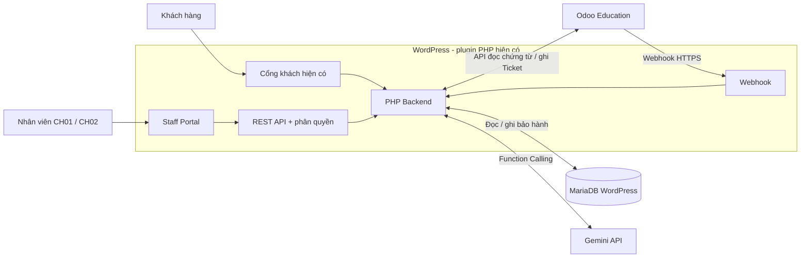
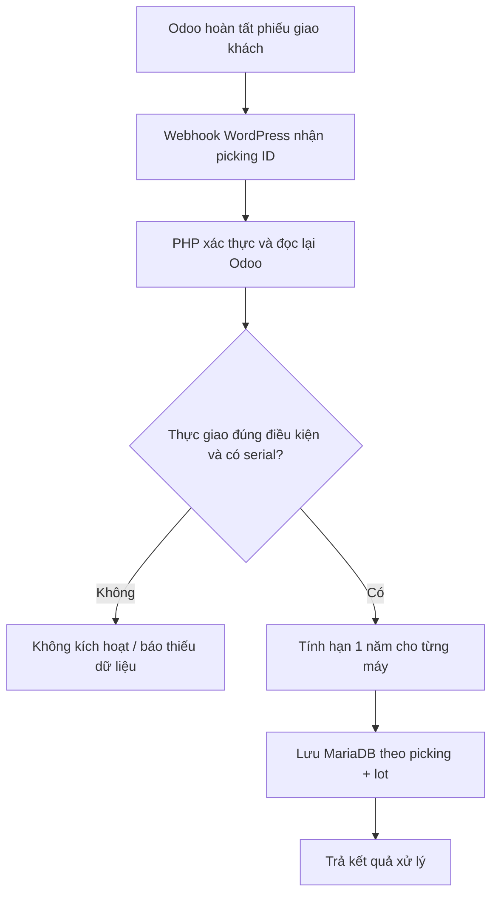

# ARCHITECTURE | CellphoneS CRM — Student MVP

**Version 2.0 · 26/11/2026**  
**Cơ sở:** `PRD_Module_IMEI_Student_MVP_v4.0.md`  
**Repository:** [cellphones-crm](https://github.com/NguyenVuQuangHuy/cellphones-crm)  
**Trạng thái:** Thiết kế đề xuất, thay thế Architecture v1.0. Chưa audit nhánh code và Odoo Education đang chạy.

## 1. Mục tiêu và quyết định thiết kế

Mở rộng plugin WordPress hiện có để tự kích hoạt bảo hành, tra cứu IMEI toàn chuỗi CH01/CH02, xác minh Helpdesk Ticket và hỏi đáp Gemini. Mục tiêu là dễ hiểu, dễ kiểm thử, dễ demo; không xây dựng hệ thống production đầy đủ.

| Quyết định | Lựa chọn |
|---|---|
| Kiến trúc | Modular Monolith đơn giản: một ứng dụng WordPress, chia mã PHP theo trách nhiệm |
| Frontend | Giao diện khách hàng hiện có + trang nhân viên HTML/CSS/JavaScript |
| Backend | PHP bên trong plugin WordPress; tái sử dụng code cũ khi phù hợp |
| Dữ liệu | Odoo sở hữu chứng từ gốc; MariaDB sở hữu hồ sơ bảo hành |
| Tích hợp | REST API, webhook HTTPS xử lý trực tiếp, Gemini Function Calling |
| Triển khai | Docker Compose WordPress + MariaDB hiện có |

**Đã chốt:** MariaDB lưu hồ sơ bảo hành; hạn chung một năm từ ngày mua. **Quy ước demo theo PRD:** ngày hoàn tất giao khách là ngày mua; không bắt buộc tạo trường ngày bảo hành trên Odoo lot. Chưa dùng FastAPI, queue/worker/cron riêng, retry tự động, RAG hoặc đồng bộ toàn bộ CRM. Không sửa WordPress core.

## 2. Sơ đồ tổng thể — hệ thống gồm những gì?



| Thành phần | Trách nhiệm |
|---|---|
| WordPress/PHP | Giao diện, kiểm tra quyền, kết nối API, tính và xác minh bảo hành |
| Odoo | Đơn bán, sản phẩm, khách hàng, serial, giao hàng, Ticket, sửa chữa, tồn kho |
| MariaDB | Hồ sơ bảo hành chính thức, tài khoản WordPress, nhật ký kỹ thuật tối thiểu |
| Gemini | Hiểu câu hỏi và diễn đạt kết quả từ các hàm đọc do PHP kiểm soát |

## 3. Tổ chức mã nguồn — mỗi file làm gì?

```text
cellphones-crm/
├── docs/
│   ├── PRD.md
│   └── ARCHITECTURE.md
├── cellphones-web/
│   ├── cellphones-portal.php   # Entry point plugin hiện có
│   ├── api.php                 # API cổng khách hiện có
│   ├── index.html              # Giao diện khách hiện có
│   └── custom-app/             # Module mới (đề xuất)
│       ├── bootstrap.php       # Nạp module, đăng ký shortcode, migration
│       ├── odoo.php            # Adapter dùng lại API client Odoo
│       ├── database.php        # Tạo bảng, lưu và tìm hồ sơ MariaDB
│       ├── warranty.php        # Logic giao hàng, hạn, tra IMEI, lịch sử
│       ├── ticket.php          # Đối chiếu và cập nhật Helpdesk Ticket
│       ├── webhook.php         # Xác thực, nhận sự kiện Odoo
│       ├── routes.php          # REST API và phân quyền
│       ├── gemini.php          # Gọi Gemini, kiểm soát hàm đọc
│       ├── staff.php           # Giao diện và shortcode nhân viên
│       ├── staff.js            # Gửi request, hiển thị kết quả
│       └── staff.css           # CSS riêng, không ảnh hưởng portal cũ
├── docker-compose.yml
└── README.md
```

Đây là cây thư mục đích, không khẳng định file đã tồn tại. Audit repo trước khi tạo; nếu có hàm tương đương thì dùng lại. Giữ `[cellphones_crm_portal]`; thêm `[cellphones_staff_portal]` (tên đề xuất). Chỉ sửa entry point cũ ở mức cần thiết để nạp module. Không buộc tạo toàn bộ file ngay; không refactor cả `api.php`.

**Quy tắc phụ thuộc:** `staff.js → routes.php → warranty.php/ticket.php/gemini.php → database.php/odoo.php`. Webhook gọi cùng logic với nút đồng bộ lại. PHP không gọi vòng qua REST của chính website. JS không tính kết luận bảo hành hay giữ API key. Dùng prefix/namespace PHP riêng; quản lý mapping field và chi nhánh tập trung trong cấu hình backend. Tách thêm file chỉ khi thật sự cần.

## 4. Data Architecture — dữ liệu lưu ở đâu?

Không sao chép danh mục, tên, số điện thoại hay toàn bộ chứng từ từ Odoo sang MariaDB. Lưu ID tham chiếu để lấy thông tin bổ sung qua Odoo khi cần và được phép.

Bảng mới: `{prefix}cellphones_warranty_records` (prefix thực tế của WordPress, không hardcode `wp_`). Schema SQL dưới đây là đề xuất tối thiểu; tạo bằng migration có version, giữ dữ liệu khi deactivate plugin.

| Cột | Kiểu đề xuất | Ý nghĩa |
|---|---|---|
| `id` | BIGINT UNSIGNED, PK, auto increment | ID nội bộ |
| `imei` | VARCHAR(64), index | Chuỗi serial, giữ số 0 đầu |
| `odoo_lot_id`, `odoo_product_id`, `odoo_order_id` | BIGINT UNSIGNED | ID serial, biến thể, đơn bán |
| `odoo_customer_id`, `odoo_picking_id` | BIGINT UNSIGNED | ID khách mua và phiếu thực giao |
| `branch_code` | VARCHAR(16), nullable | CH01/CH02 hoặc chưa xác định |
| `purchase_date`, `warranty_start`, `warranty_end` | DATE, nullable | Ngày mua/bắt đầu/hết hạn; NULL nếu chưa xác định |
| `created_at`, `updated_at` | DATETIME | Thời điểm lưu/cập nhật (UTC đề xuất) |

- `UNIQUE(odoo_picking_id, odoo_lot_id)` (hai cột NOT NULL): cùng phiếu và lot không sinh hồ sơ trùng; index IMEI để tra nhanh. Không đặt UNIQUE chỉ theo IMEI vì có thể có lần bán khác. Dùng WordPress `$wpdb` với truy vấn tham số hóa.
- Chỉ tính trạng thái Còn hạn/Hết hạn khi có đủ căn cứ; không lưu cố định trạng thái theo thời gian. Không tự gia hạn hoặc ghi đè lần mua cũ khi nhận lại webhook; nếu nhiều hồ sơ/lần bán mơ hồ thì yêu cầu kiểm tra lại.
- Quy tắc demo: `purchase_date = warranty_start = ngày hoàn tất giao khách`, `warranty_end = purchase_date + 1 năm lịch` theo `Asia/Ho_Chi_Minh`; 29/02 → 28/02 nếu năm sau không nhuận. Ngày cuối vẫn còn hạn. Trên Ticket xét tại ngày tiếp nhận nếu có, nếu không dùng ngày xác minh và ghi rõ.

### Mapping Odoo cần kiểm chứng trước khi lập trình

| Model / field theo PRD | Công dụng |
|---|---|
| `stock.lot.id`, `stock.lot.name` | ID và IMEI/serial gốc |
| `stock.picking.sale_id`, `stock.move.line.picking_id`, `lot_id`, `product_id` | Liên kết phiếu thực giao, đơn bán, serial, biến thể |
| `helpdesk.ticket.sale_order_id` | Đơn bán trên Ticket |
| `x_studio_san_pham_danh_muc`, `x_studio_so_imei_serial`, `x_studio_cua_hang_tiep_nhan` | Biến thể, IMEI và cửa hàng tiếp nhận |
| `repair.order.lot_id`, `stock.move.origin_returned_move_id` | Lịch sử sửa và chứng từ trả có căn cứ |
| `x_studio_che_do_bao_hanh` | Kết luận của người phụ trách; app không tự sửa |

Cần xác minh field ngày hoàn tất, dòng thực giao, kiểu dữ liệu, mã selection, cách xác định kho/vị trí của CH01/CH02 và trường kết quả Ticket. Không tự đoán tên field, ID kho hay coi mọi đơn web là CH01. Nếu không có trường kết quả Ticket phù hợp, thử ghi chú nội bộ có cấu trúc (nếu quyền cho phép); ghi rõ kết quả mới thay thế kết quả cũ. Không để dữ liệu kết quả cũ xuất hiện như kết luận hiện hành.

## 5. Data Flow — bốn chức năng chính

### F01 — Kích hoạt bảo hành tự động



Không kích hoạt khi đặt COD, xác nhận báo giá hay chuyển nội bộ. Phiếu có hai máy tạo hai hồ sơ; giao từng phần chỉ tạo cho serial thực giao. Thiếu ngày hợp lệ: ghi nhận máy đã giao nếu đủ định danh nhưng để hạn NULL. Nếu API hoặc ghi DB lỗi, báo lỗi và cho quản trị chạy lại theo ID; việc chạy lại an toàn ngay cả khi một phần phiếu đã lưu.

### F02 — Tra cứu IMEI

`Staff Portal → REST → warranty.php → MariaDB → Odoo (thông tin bổ sung) → giao diện`.

Hiển thị IMEI, sản phẩm, nơi giao, ngày mua/hạn, trạng thái, lịch sử và mã/link chứng từ nếu có. Tra cứu không tạo Ticket; hỗ trợ cả bốn tổ hợp CH01/CH02. Không có hồ sơ thì báo Chưa có hồ sơ bảo hành. Odoo lỗi: vẫn xem dữ liệu bảo hành đã lưu, có cảnh báo chưa xác minh mới thông tin Odoo; không giả lập lịch sử hay quyết định miễn phí. Nếu phát hiện đổi/trả/bán lại thì báo Cần kiểm tra lại.

### F03 — Xác minh Ticket

`Odoo lưu Ticket → webhook → ticket.php đọc Ticket + chứng từ Odoo → tìm hồ sơ MariaDB → ghi kết quả về cùng Ticket`.

Kiểm tra đơn bán + biến thể + IMEI thực giao. Kết quả đối chiếu: Khớp / Không khớp (chỉ khi đủ bằng chứng) / Chưa đủ dữ liệu. Thời hạn: Còn hạn / Hết hạn / Chưa xác định / Cần kiểm tra lại. Ghi lý do, hạn nếu xác định, căn cứ, thời điểm kiểm tra; xóa/thay thế kết quả cũ khi đổi IMEI. Lỗi quyền/API không phải Không khớp. Ticket online thiếu đơn/IMEI vẫn giữ mã cũ để bổ sung. Automation chỉ theo dõi đầu vào; đọc lại đầu vào trước khi ghi để giảm nguy cơ ghi kết quả cũ. Không ghi đè kết luận kỹ thuật.

### F04 — Gemini Copilot

`Nhân viên hỏi → Gemini đề xuất hàm → PHP kiểm tra quyền/tham số → đọc Odoo/MariaDB → Gemini diễn đạt → giao diện`.

Ưu tiên `lookup_imei`, `get_ticket_status`, `get_repair_history`, `get_branch_inventory`; `get_sale_order` nếu còn thời gian. Dùng chung logic tra cứu F02, chỉ cho phép hàm đọc; không cho AI tự gọi truy vấn SQL/API tùy ý. Tồn kho theo chi nhánh phải có mapping; phân biệt tồn thực tế và chưa giữ chỗ khi có dữ liệu. Trả lời có căn cứ/thời điểm, thiếu dữ liệu thì nói rõ. Giới hạn lượt gọi, timeout và lọc PII. Gemini lỗi không làm gián đoạn F01–F03 nếu các hệ thống cần thiết còn kết nối.

## 6. REST API — các điểm giao tiếp đề xuất

Base path: `/wp-json/cellphones/v1` (route đăng ký qua `rest_api_init`, dùng `permission_callback`).

| Method / route | Quyền | Input → Output |
|---|---|---|
| POST `/staff/imei/lookup` | Nhân viên | `imei` (string) → hồ sơ, trạng thái, lịch sử/cảnh báo |
| POST `/staff/copilot/chat` | Nhân viên | `message`, IMEI/Ticket ngữ cảnh tùy chọn → câu trả lời, căn cứ |
| POST `/webhooks/odoo/delivery` | Odoo credential | `picking_id` → kết quả xử lý phiếu |
| POST `/webhooks/odoo/ticket` | Odoo credential | `ticket_id` → kết quả xác minh |
| POST `/admin/sync` | Quản trị | `type` (delivery/ticket), `record_id` → kết quả chạy lại |

Tên route và JSON là đề xuất, adapter chuẩn hóa payload ID thực của Odoo. Không tin IMEI, trạng thái hay quyền từ webhook; đọc lại chứng từ. Trả HTTP 200 sau khi xử lý/lưu thành công (kể cả sự kiện đã xử lý); 400 đầu vào lỗi, 401/403 xác thực/quyền, 5xx lỗi kỹ thuật; không trả thành công giả. Kết luận nghiệp vụ thiếu dữ liệu là kết quả xử lý hợp lệ, tách khỏi lỗi API. Phản hồi có `ok`, `data` hoặc `error` (mã/lý do đã lọc); không trả dữ liệu nội bộ qua webhook.

## 7. Bảo mật và vận hành tối thiểu

- Nhân viên đăng nhập WordPress; kiểm tra capability và REST nonce `X-WP-Nonce`. Quyền nhân viên toàn chuỗi theo dữ liệu được phép xem; khách không được đọc API staff; quản trị mới được đồng bộ lại. Nonce không thay thế kiểm tra quyền. Không thêm route nội bộ vào dispatcher công khai.
- Webhook có credential riêng, dùng HTTPS và kiểm tra cơ chế header/chữ ký thực tế Odoo hỗ trợ. Không giả định HMAC có sẵn. Nếu không có cơ chế xác thực phù hợp, báo blocker; chưa mở webhook live không xác thực. API key/secret chỉ ở server, không vào JS/Git/log; Odoo dùng tài khoản tích hợp quyền tối thiểu.
- Xử lý webhook trực tiếp trong PHP với timeout hữu hạn; không queue/worker/cron riêng. Ghi log kỹ thuật tối thiểu gồm loại sự kiện, ID chứng từ, thành công/lỗi, thời điểm; không ghi secret hoặc dữ liệu khách nhạy cảm. Nút đồng bộ lại dùng cùng hàm nghiệp vụ, không tạo bản ghi trùng.
- Local dùng Compose hiện có, live/mock phân biệt rõ. Deploy lên máy chủ luôn hoạt động, dùng HTTPS (reverse proxy hiện có nếu phù hợp), DB volume bền vững, không public MariaDB. Backup DB trước migration. Odoo cần truy cập được URL webhook live; localhost không nhận trực tiếp webhook Internet. Không tự fallback mock khi live lỗi.

**Giới hạn MVP:** webhook có thể mất hoặc timeout; chưa bảo đảm retry tự động, chống race tuyệt đối hay đồng bộ toàn bộ đổi/trả. Nhân viên kiểm tra lại thủ công khi phát hiện bất thường; không tuyên bố hệ thống production-ready.

## 8. Lộ trình code và nghiệm thu

| Chặng | Việc cần làm | Điều kiện qua chặng |
|---|---|---|
| 1 | Audit repo, thử API đọc phiếu/serial/Ticket, ghi Ticket thử, webhook HTTPS, mapping | Có bằng chứng trên Odoo thật; xác nhận portal cũ chạy |
| 2 | `database.php`, `warranty.php` | Tạo/đọc hồ sơ, tính đúng hạn, không trùng (T02, T05) |
| 3 | `routes.php`, Staff Portal | Tra IMEI, phân quyền, tra liên chi nhánh (T03, T09) |
| 4 | Webhook giao hàng + chạy lại thủ công | Giao máy tự tạo hồ sơ; lỗi có thể chạy lại (T01, T02, T08) |
| 5 | `ticket.php`, webhook Ticket, lịch sử | Đúng/sai/thiếu dữ liệu, đổi IMEI, lịch sử có căn cứ (T04, T06) |
| 6 | Gemini Function Calling | Hỏi có căn cứ, không ghi, AI lỗi không phá core (T07) |
| 7 | Deploy và regression | T01–T11 của PRD, đặc biệt portal cũ và live laptop tắt (T10, T11) |

Chuẩn bị đơn A tại CH01 có SN-A1/SN-A2, đơn B tại CH02 có SN-B1 (serial thử hợp lệ). Demo 4 màn: giao máy → MariaDB; tra IMEI liên chi nhánh; Ticket tự cập nhật; Gemini hỏi dữ liệu thật. Quay minh chứng 4.8 và Gemini 4.7; Brevo/Cloudinary/Telegram giữ theo phân công, không viết lại trong IMEI module.

## 9. Cách kiểm soát Codex và những điểm chưa chốt

Với từng chặng: đọc PRD/Architecture và code → AI đề xuất file sửa, data flow và test (chưa sửa) → người dùng duyệt → code phạm vi nhỏ → tự chạy test, kiểm tra `git diff` → commit sau khi review. Dùng feature branch; không yêu cầu AI tạo toàn bộ module trong một lượt. Nếu thay đổi thiết kế, ghi lý do vào tài liệu trước khi code; không tự thêm framework, trường Odoo, chính sách hay credential. Chỉ dùng DB thử được phép và phân biệt kết quả mock/live.

**Preflight còn cần xác minh:** code/commit mới nhất và client API dùng lại; quyền đọc/ghi Odoo Education; payload/credential webhook; field ngày giao, serial thực giao và kết quả Ticket; mapping CH01/CH02; hosting HTTPS. Nếu không đủ quyền ghi hoặc webhook không chạy, dùng đồng bộ thủ công có nhãn để phát triển, nhưng không đánh dấu đạt tự động hóa. Cây thư mục, schema SQL và route ở trên là lựa chọn thiết kế đề xuất, không phải code đã tồn tại. Quy ước ngày giao là ngày mua và phạm vi đơn giản hóa được kế thừa từ PRD v4.0; thay đổi phải cập nhật cả PRD lẫn Architecture.

**Ghi nhớ:** Odoo giữ chứng từ; MariaDB giữ bảo hành; PHP xử lý nghiệp vụ; WordPress hiển thị; Gemini hỗ trợ hỏi đáp. Hiểu đường đi dữ liệu của từng chức năng trước khi yêu cầu AI lập trình.
