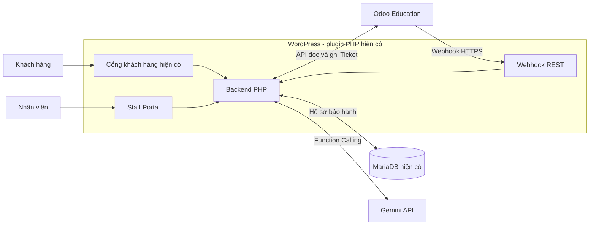

# PRD | Quản lý bảo hành và vòng đời điện thoại theo IMEI

**Phiên bản 4.0 — Student MVP | 26/11/2026**  
**Dự án:** CellphoneS CRM — Odoo Education | **Nhóm:** 4 thành viên  
**Repository:** [cellphones-crm](https://github.com/NguyenVuQuangHuy/cellphones-crm)  
**Cơ sở:** PRD v3.0 và các quyết định đơn giản hóa sau đó.

## 1. Mục tiêu sản phẩm

Mở rộng website WordPress hiện có bằng một Custom App do nhóm tự lập trình, giúp nhân viên CH01 và CH02 tra cứu bảo hành theo IMEI, xác minh thiết bị khi tiếp nhận Helpdesk Ticket và hỏi đáp dữ liệu bằng Gemini.

Khi máy được giao thành công, hệ thống tự tạo hồ sơ bảo hành trong MariaDB. Nhân viên ở bất kỳ cửa hàng nào được cấp quyền đều có thể tra cứu cùng hồ sơ này, xem thông tin mua hàng, thời hạn bảo hành và lịch sử tiếp nhận/sửa chữa có trên Odoo.

**Mục tiêu MVP:** hoạt động được với dữ liệu thử thật trên Odoo, dễ hiểu, dễ phát triển từng bước bằng AI Coding và trình diễn rõ chức năng trước giảng viên. Không mô phỏng toàn bộ chính sách vận hành của CellphoneS ngoài thực tế.

## 2. Phạm vi

| Hạng mục | Yêu cầu MVP |
|---|---|
| Website khách hàng | Giữ nguyên danh mục, tư vấn, COD, gửi yêu cầu và tra tiến độ bảo hành hiện có. |
| Kích hoạt bảo hành | Tự tạo hồ sơ theo từng IMEI khi nhận sự kiện giao máy thành công từ Odoo. |
| Tra cứu thiết bị | Nhập IMEI trên trang nhân viên; xem hồ sơ, hạn bảo hành, chứng từ và lịch sử có căn cứ. |
| Helpdesk | Tự đối chiếu đơn bán, biến thể, IMEI; cập nhật kết quả về Ticket Odoo. |
| Gemini Copilot | Hỏi đáp tiếng Việt dựa trên dữ liệu MariaDB và Odoo; chỉ đọc. |
| Vận hành | Chạy local và deploy trên website hiện có; có cách đồng bộ lại thủ công khi lỗi. |

**Ngoài phạm vi MVP:** gói bảo hành mở rộng, tự động quyết định sửa miễn phí, xử lý đầy đủ đổi/trả/bán lại, đồng bộ toàn bộ CRM, RAG/vector database, FastAPI, hàng đợi/worker và retry tự động phức tạp. Có thể mở rộng sau khi bản demo ổn định. Không đánh dấu máy trả/đổi là đủ điều kiện nếu đã biết quyền lợi chưa rõ.

## 3. Người dùng và hành trình

- **Khách hàng:** tiếp tục sử dụng cổng khách hàng hiện có, không được truy cập hồ sơ IMEI nội bộ.
- **Nhân viên CH01/CH02:** đăng nhập WordPress, tra thiết bị toàn chuỗi, hỏi Gemini; thao tác nghiệp vụ trên Odoo.
- **Quản trị:** cấu hình kết nối, ánh xạ chi nhánh, kiểm tra lỗi và đồng bộ lại chứng từ.

| Nơi thực giao | Tiếp nhận tại CH01 | Tiếp nhận tại CH02 |
|---|---|---|
| CH01 | Hỗ trợ | Hỗ trợ |
| CH02 | Hỗ trợ | Hỗ trợ |

Cửa hàng giao và cửa hàng tiếp nhận là hai thông tin độc lập. Tra cứu tại cửa hàng khác không tạo hồ sơ bảo hành mới.

## 4. Kiến trúc tổng quan

- Một ứng dụng WordPress, một codebase PHP, sử dụng MariaDB và Docker Compose hiện có. Không xây dựng website/backend độc lập.
- Odoo giữ chứng từ gốc: sản phẩm, đơn hàng, khách hàng, serial, giao hàng, Ticket, sửa chữa và tồn kho.
- MariaDB giữ hồ sơ bảo hành chính thức do app tạo, tài khoản WordPress và nhật ký kỹ thuật cần thiết. Không sao chép toàn bộ CRM.
- PHP quyết định kết quả theo quy tắc cố định. Gemini hỗ trợ hiểu câu hỏi và diễn đạt kết quả từ các hàm đọc do PHP kiểm soát.

## 5. Quy tắc bảo hành

**Quyết định đã chốt:** lưu hồ sơ bảo hành tại MariaDB vì Odoo hiện chưa có trường riêng ngày bắt đầu và ngày hết hạn bảo hành trên từng serial hoặc chi tiết đơn bán. Chính sách chung: ngày hết hạn = ngày mua + 1 năm.

**Quy ước demo được đề xuất áp dụng trong v4.0:**

- Lấy ngày hoàn tất phiếu giao khách làm ngày mua/ngày bắt đầu bảo hành; chỉ kích hoạt khi phiếu giao khách đã `done` và có serial thực giao. Không kích hoạt lúc đặt hàng COD, xác nhận báo giá hoặc chuyển kho nội bộ.
- Cộng một năm theo lịch, không cố định 365 ngày; ngày 29/02 chuyển sang 28/02 nếu năm sau không nhuận. Múi giờ nghiệp vụ: Việt Nam (`Asia/Ho_Chi_Minh`).
- Ngày hết hạn là ngày cuối còn hiệu lực. Trạng thái được tính khi tra cứu (không cần cập nhật hàng ngày). Trên Ticket dùng ngày tiếp nhận nếu có, nếu không dùng ngày xác minh và nêu rõ.
- Không tự suy diễn ngày mua/chi nhánh/IMEI khi chứng từ thiếu. Máy đã giao nhưng thiếu ngày hợp lệ có trạng thái **Chưa xác định** thời hạn.
- Nếu phát hiện trả hàng, đổi hoặc bán lại, hiển thị **Cần kiểm tra lại**; không tự gia hạn hoặc ghi đè lần mua trước. Demo cơ bản dùng máy bán lần đầu. Kết luận miễn phí thuộc nhân viên có thẩm quyền.

Ví dụ: máy giao ngày 26/11/2026, hết hạn ngày 26/11/2027; ngày 26/11/2027 còn hạn, ngày 27/11/2027 hết hạn.

## 6. Các luồng nghiệp vụ

### F01 — Tự động kích hoạt bảo hành

1. Nhân viên xác nhận đơn trên Odoo, gán serial cho từng máy và hoàn tất phiếu giao khách.
2. Automation Odoo gửi ID phiếu giao đến REST webhook của WordPress.
3. PHP xác thực webhook, gọi API Odoo để đọc lại phiếu và dòng hàng đã giao, xác định serial, sản phẩm, đơn bán, ngày giao và chi nhánh thực giao.
4. PHP tính hạn một năm và lưu hồ sơ bảo hành vào MariaDB. Đơn giao hai máy tạo hai hồ sơ. Phiếu giao từng phần chỉ xử lý máy thực giao.
5. Nhân viên tra được hồ sơ mới trên trang nội bộ. Nhận lại cùng webhook không tạo bản ghi trùng hoặc gia hạn lần nữa.

Nếu thiếu serial hoặc API lỗi, báo lỗi/thiếu dữ liệu, cho phép quản trị đồng bộ lại theo ID phiếu. Không yêu cầu thêm trường ngày bảo hành trên `stock.lot`.

### F02 — Tra cứu IMEI liên chi nhánh

1. Nhân viên đăng nhập trang **Nhân viên → Tra cứu thiết bị**, nhập hoặc quét IMEI.
2. Backend tìm hồ sơ trong MariaDB và tính thời hạn tại ngày tra cứu.
3. Nếu cần, lấy thêm thông tin sản phẩm, khách hàng được phép xem, lịch sử và chứng từ qua Odoo API.
4. Hiển thị IMEI, sản phẩm, cửa hàng thực giao, ngày mua, ngày bắt đầu, ngày hết hạn, trạng thái và liên kết chứng từ. Lịch sử gồm ngày, sự kiện, cửa hàng, mã chứng từ khi có căn cứ.

Nếu chưa có hồ sơ: báo **Chưa có hồ sơ bảo hành**, không suy ra máy hết hạn. Có thể đồng bộ lại phiếu giao cũ khi xác định đúng chứng từ. Nếu Odoo lỗi, hồ sơ MariaDB vẫn có thể xem với cảnh báo thông tin Odoo chưa được xác minh mới; không hiển thị lịch sử giả hoặc tự quyết định miễn phí. Không tạo Ticket chỉ vì tra cứu.

### F03 — Xác minh Helpdesk Ticket

1. Nhân viên tiếp nhận thiết bị tại quầy và lưu Ticket Odoo có đơn bán, biến thể, IMEI thực tế và cửa hàng tiếp nhận.
2. Odoo gửi webhook khi tạo Ticket hoặc thay đổi trường đầu vào xác minh. PHP đọc lại Ticket và đối chiếu IMEI với đúng đơn, biến thể, phiếu thực giao trên Odoo; lấy hồ sơ bảo hành từ MariaDB.
3. Ghi kết quả về chính Ticket: đối chiếu IMEI, tình trạng thời hạn, hạn bảo hành nếu xác định được, lý do, mã chứng từ/căn cứ và thời điểm kiểm tra. Nếu đổi IMEI, xóa kết quả cũ không còn phù hợp trước khi lưu kết quả mới. Không ghi đè kết luận kỹ thuật của nhân viên.
4. Ticket online hiện có vẫn dùng mã cũ; nếu thiếu đơn bán/IMEI, hiển thị Chưa đủ dữ liệu. Nhân viên bổ sung vào cùng Ticket rồi xác minh lại.

| Nhóm kết quả | Giá trị |
|---|---|
| Đối chiếu IMEI | Khớp / Không khớp / Chưa đủ dữ liệu |
| Thời hạn | Còn hạn / Hết hạn / Chưa xác định / Cần kiểm tra lại |
| Lỗi kỹ thuật | Lỗi kết nối, quyền hoặc cấu hình — không phải Không khớp |

Chỉ kết luận Không khớp khi có đủ bằng chứng. Chỉ kết luận Còn hạn/Hết hạn khi đã xác minh đúng thiết bị và có ngày hợp lệ. Nếu quyền lợi chưa rõ vì trả/đổi máy, yêu cầu kiểm tra thủ công. Trường hợp chưa có hồ sơ có thể đồng bộ lại phiếu giao rồi xác minh lại.

### F04 — Gemini Copilot

Nhân viên nhập câu hỏi tiếng Việt. Gemini đề xuất hàm; PHP kiểm tra quyền và tham số, đọc dữ liệu rồi trả kết quả để Gemini diễn đạt. Câu trả lời kèm căn cứ và thời điểm tra cứu. Ưu tiên 3–5 hàm sau:

| Hàm đề xuất | Nguồn dữ liệu | Câu hỏi mẫu |
|---|---|---|
| `lookup_imei` | MariaDB + Odoo | Máy này còn bảo hành không? |
| `get_ticket_status` | Odoo + kết quả xác minh | Ticket này đã được xác minh chưa? |
| `get_repair_history` | Odoo | Máy đã sửa ở cửa hàng nào? |
| `get_branch_inventory` | Odoo | CH02 còn bao nhiêu máy của biến thể này? |
| `get_sale_order` (mở rộng nếu đủ thời gian) | Odoo | Máy thuộc đơn bán nào? |

Tồn kho riêng theo chi nhánh chỉ trả khi đã ánh xạ kho/vị trí. Nếu có số lượng giữ chỗ, phân biệt tồn thực tế và chưa giữ chỗ. Gemini không có hàm ghi, không đọc tùy ý mọi dữ liệu, không tự tạo dữ liệu hoặc tự kết luận bảo hành miễn phí. Khi Gemini lỗi, các luồng F01–F03 và cổng khách hàng cốt lõi vẫn hoạt động nếu các hệ thống cần thiết còn kết nối.

## 7. Dữ liệu và giao diện

### 7.1. Hồ sơ bảo hành MariaDB (schema tối thiểu đề xuất)

Bảng `{prefix}cellphones_warranty_records` trong database WordPress hiện có. Đây là thiết kế sơ bộ, không phải migration đã chạy.

| Trường | Ý nghĩa |
|---|---|
| `id` | Khóa chính nội bộ |
| `imei` | Chuỗi serial/IMEI, giữ số 0 ở đầu |
| `odoo_lot_id` | ID serial trên Odoo |
| `odoo_product_id`, `odoo_order_id` | Tham chiếu biến thể và đơn bán |
| `odoo_customer_id`, `odoo_picking_id` | Tham chiếu khách mua và phiếu thực giao |
| `branch_code` | CH01, CH02 hoặc chưa xác định |
| `purchase_date`, `warranty_start`, `warranty_end` | Ngày mua và hạn bảo hành |
| `created_at`, `updated_at` | Thời điểm lưu/cập nhật |

Chống trùng bằng khóa duy nhất theo phiếu giao + lot (trong phạm vi một database Odoo của đồ án). Tra cứu theo IMEI/lot; nếu có nhiều lần bán hoặc nhiều lot mơ hồ, yêu cầu kiểm tra lại thay vì chọn bừa. Không lưu cố định Còn hạn/Hết hạn; tính từ ngày. Không cần lưu bản sao tên, số điện thoại hoặc toàn bộ sản phẩm. Có thể lấy các dữ liệu này từ Odoo theo quyền.

### 7.2. Liên kết dữ liệu Odoo

| Model/trường tham chiếu từ PRD v3.0 | Công dụng |
|---|---|
| `stock.lot.name`, `stock.lot.id` | Serial/IMEI gốc và ID thiết bị |
| `stock.picking.sale_id`, `stock.move.line.picking_id`, `lot_id`, `product_id` | Căn cứ máy thực giao thuộc đơn/biến thể |
| `helpdesk.ticket.sale_order_id` | Đơn bán trên Ticket |
| `x_studio_san_pham_danh_muc`, `x_studio_so_imei_serial`, `x_studio_cua_hang_tiep_nhan` | Biến thể, IMEI quầy nhập, nơi tiếp nhận |
| `repair.order.lot_id`, `stock.move.origin_returned_move_id` | Lịch sử sửa và chứng từ trả nếu có |
| `x_studio_che_do_bao_hanh` | Kết luận của người phụ trách, không để AI tự sửa |

Tên trường trên được kế thừa từ PRD, cần đối chiếu schema/quyền thực tế trước khi code. Trên Ticket cần có nơi lưu kết quả xác minh (ưu tiên các trường Studio nếu khả dụng; phương án demo dự phòng là ghi chú nội bộ có cấu trúc nếu được phép ghi). Không tạo trường ngày bảo hành trên lot như điều kiện bắt buộc. Xác định chi nhánh bằng kho/vị trí/trường thực giao đã kiểm chứng; không mặc định mọi đơn web thuộc CH01.

### 7.3. Màn hình

| Màn hình | Nội dung |
|---|---|
| Cổng khách hàng cũ | Giữ các chức năng và tra tiến độ bằng mã phiếu + số điện thoại |
| Staff Portal | Đăng nhập, ô IMEI, kết quả, lịch sử, liên kết chứng từ |
| AI Copilot | Khung chat, câu hỏi mẫu, căn cứ trả lời và lỗi rõ ràng |
| Helpdesk Odoo | Kết quả đối chiếu, hạn, lý do, thời điểm, căn cứ trên cùng Ticket |
| Quản trị | Đồng bộ lại phiếu giao/Ticket bằng ID, xem lỗi và lần cập nhật gần nhất |

## 8. Yêu cầu tích hợp và vận hành MVP

- Giữ entry point/shortcode khách hàng `[cellphones_crm_portal]`; bổ sung khu vực nhân viên (shortcode đề xuất `[cellphones_staff_portal]`). Tái sử dụng Odoo client và cấu hình hiện có nếu phù hợp. Không refactor toàn bộ website.
- REST riêng cho tra IMEI, chat, webhook giao máy, webhook Ticket và đồng bộ lại; không đưa action nội bộ vào dispatcher công khai. Chi tiết route/schema và cấu trúc file thuộc Architecture, không phải yêu cầu nghiệp vụ cố định.
- Webhook MVP xử lý trực tiếp bằng PHP, không yêu cầu queue/worker/cron. Xác thực nguồn gửi, đọc lại Odoo, giới hạn thời gian gọi API; chỉ báo thành công sau khi lưu/ghi kết quả thành công. Lỗi phải quan sát được và cho phép chạy lại thủ công an toàn. Chấp nhận chưa có bảo đảm retry tự động; không tuyên bố webhook luôn được giao thành công.
- Automation Ticket chỉ theo dõi đầu vào để tránh vòng lặp khi app ghi kết quả. Nếu phát hiện đầu vào đã đổi trong lúc xử lý, không ghi kết quả cũ; cho xác minh lại. Không yêu cầu cơ chế xử lý đồng thời nâng cao trong MVP.
- Staff API kiểm tra session/capability WordPress và nonce phù hợp; webhook dùng credential riêng tương thích với khả năng Odoo thực tế. HTTPS khi deploy; secret chỉ ở backend, không đưa vào JS, Git, phản hồi hay log. Lọc thông tin cá nhân trước khi gửi Gemini. Khách không thể đọc dữ liệu nội bộ kể cả gọi API trực tiếp.
- Local dùng Docker Compose hiện có; live sử dụng máy chủ có HTTPS mà Odoo truy cập được. Bật live rõ ràng khi demo; fixture/mock chỉ dùng học và kiểm thử, không thay thế dữ liệu thật khi lỗi. Website đã deploy hoạt động khi laptop tắt.

**Preflight bắt buộc:** kiểm tra API Odoo Education thực tế đọc được phiếu giao/serial/Ticket và ghi được kết quả Ticket thử; thử webhook HTTPS; xác định mapping chi nhánh và trường cần dùng; kiểm tra website cũ. Nếu không hỗ trợ webhook hoặc quyền ghi, báo blocker và dùng thao tác thủ công có nhãn để phát triển/test, không tuyên bố đã đạt tự động hóa khi chưa có bằng chứng.

## 9. Kịch bản trình diễn và tiêu chí nghiệm thu

Dữ liệu thử: đơn A giao CH01 có `SN-A1`, `SN-A2` cùng biến thể; đơn B giao CH02 có `SN-B1`. Dùng các serial thử hợp lệ theo database, không dùng dữ liệu khách thật nếu không được phép.

| ID | Thao tác trình diễn / kiểm thử | Kết quả đạt |
|---|---|---|
| T01 | Hoàn tất phiếu giao A và B trên Odoo | Webhook tự tạo 3 hồ sơ MariaDB, đúng IMEI, đơn, chi nhánh, hạn 1 năm. Chuyển nội bộ/chưa giao không kích hoạt. |
| T02 | Gửi lại webhook A | Không tạo hồ sơ trùng, không thay đổi hạn chỉ vì nhận lại sự kiện. |
| T03 | Nhân viên CH02 tra máy CH01 và ngược lại; thử cả hai trường hợp cùng chi nhánh | Cùng hồ sơ thiết bị, đúng cửa hàng thực giao; tra cứu không tạo Ticket. |
| T04 | Lưu Ticket đúng đơn/biến thể/IMEI; đổi sang IMEI sai đơn; thử thiếu dữ liệu | Kết quả lần lượt Khớp, Không khớp (đủ bằng chứng), Chưa đủ dữ liệu; không còn liên kết/kết quả cũ sai. |
| T05 | Tra ngày cuối bảo hành và ngày kế tiếp (fixture ngày phù hợp) | Còn hạn rồi Hết hạn; máy chưa có hồ sơ không bị kết luận hết hạn. |
| T06 | Tra lịch sử sửa đã có trên Odoo; nếu phát hiện trả/đổi | Đúng máy, đúng chứng từ; tình huống quyền lợi chưa rõ báo cần kiểm tra lại. |
| T07 | Hỏi Gemini về IMEI/Ticket/tồn kho; thử yêu cầu ghi; tắt Gemini | Câu trả lời có căn cứ, không ghi dữ liệu; chức năng cốt lõi vẫn chạy. |
| T08 | Mô phỏng API lỗi, khôi phục và đồng bộ lại theo ID | Có cảnh báo lỗi; chạy lại được, không tạo hồ sơ trùng hoặc kết luận Không khớp do lỗi mạng. |
| T09 | Gọi webhook sai credential; khách gọi API staff | Từ chối, không lộ hồ sơ nội bộ. |
| T10 | Kiểm thử catalog, tư vấn, COD, gửi yêu cầu, tra tiến độ trước/sau module | Không phá chức năng cũ; bổ sung đơn vào Ticket online vẫn giữ mã phiếu. |
| T11 | Demo từ website HTTPS kết nối Odoo thật, laptop phát triển tắt | F01–F04 hoạt động và có minh chứng đối chiếu Odoo/MariaDB. |

**Bốn màn demo chính:** (1) giao máy → tự sinh hồ sơ MariaDB; (2) tra IMEI khác chi nhánh; (3) lưu Ticket → tự cập nhật kết quả; (4) hỏi Gemini dựa trên dữ liệu thật. Chuẩn bị sẵn dữ liệu thử, không tạo kết quả giả để che lỗi.

## 10. Minh chứng đồ án 4.7 và 4.8

| Hạng mục | Minh chứng |
|---|---|
| 4.8 — Custom App | Mã PHP do nhóm phát triển, bản ghi MariaDB tự sinh khi giao, Staff Portal và Ticket có kết quả xác minh. |
| 4.7 — Gemini | Câu hỏi, hàm đọc được chọn, dữ liệu nguồn và câu trả lời có căn cứ. |
| 4.7 — Brevo, Cloudinary, Telegram | Giữ phạm vi tích hợp của nhóm từ PRD v3.0: email theo Ticket, ảnh tiếp nhận/bàn giao và thông báo nội bộ. Không bắt buộc module IMEI triển khai lại ba tích hợp; cung cấp minh chứng riêng theo phân công. |

## 11. Kế hoạch triển khai và cách làm việc với AI

| Chặng | Công việc | Đầu ra có thể kiểm chứng |
|---|---|---|
| 1 | Audit repo, thử kết nối Odoo, mapping và quyền | Đọc được chứng từ thật, ghi thử Ticket, kiểm tra webhook |
| 2 | MariaDB, PHP warranty logic | Tạo/đọc hồ sơ thử, tính hạn đúng, không trùng |
| 3 | Staff Portal và phân quyền | Nhân viên tra được IMEI, khách bị từ chối |
| 4 | Webhook giao hàng | Giao máy Odoo tự tạo hồ sơ, đồng bộ lại được |
| 5 | Xác minh Ticket | Đối chiếu đúng, sai, thiếu dữ liệu; ghi lại Odoo |
| 6 | Gemini | Hỏi đáp có căn cứ, chỉ đọc |
| 7 | Deploy và nghiệm thu | Chạy các ca T01–T11, quay minh chứng |

Gợi ý 2–3 tuần: tuần 1 chặng 1–3; tuần 2 chặng 4–6 và deploy; thời gian còn lại chặng 7. Ưu tiên luồng kích hoạt và tra cứu trước khi đầu tư UI/AI nâng cao. Bốn thành viên có thể chia: tích hợp Odoo/deploy; database/logic bảo hành; giao diện/Ticket/phân quyền; Gemini/QA. Thống nhất giao diện kết nối trước khi làm song song.

Với mỗi task: AI khảo sát không sửa code → đề xuất kế hoạch và file thay đổi → người dùng duyệt → code một chức năng → tự chạy test và review Git diff → commit. Không yêu cầu Codex triển khai cả PRD trong một lượt. Không tự thêm framework hoặc trường Odoo chưa kiểm chứng.

## 12. Quyết định và giới hạn cần theo dõi

| Nội dung | Trạng thái |
|---|---|
| MariaDB sở hữu hồ sơ bảo hành, Odoo sở hữu chứng từ gốc | Đã chốt theo yêu cầu người dùng |
| Thời hạn chung 1 năm tính từ ngày mua | Đã chốt theo yêu cầu người dùng |
| Mở rộng WordPress hiện có, ưu tiên Student MVP | Đã chốt theo yêu cầu người dùng |
| Ngày giao hoàn tất được quy ước là ngày mua; ngày hết hạn tính bao gồm ngày cuối; xử lý 29/02 | Quy ước demo đề xuất, cần đổi nếu nhóm chọn khác |
| Xử lý webhook trực tiếp, chạy lại thủ công; hoãn gói mở rộng/đổi trả tự động | Đơn giản hóa đề xuất cho MVP, không phải bảo đảm vận hành production |
| Tên field, mapping CH01/CH02, quyền API, webhook credential, hosting | Chưa xác minh trên hệ thống hiện tại; preflight trước khi triển khai |

PRD v4.0 thay thế các yêu cầu tương ứng của v3.0 về nơi lưu hồ sơ, chính sách bảo hành và xử lý nền. `ARCHITECTURE.md` v1.0 cũ chưa phản ánh các thay đổi này; cần cập nhật thành bản Student MVP trước khi dùng làm chỉ dẫn chính thức cho Codex. Không coi tài liệu này là xác nhận chức năng đã được lập trình hoặc kiểm thử.
